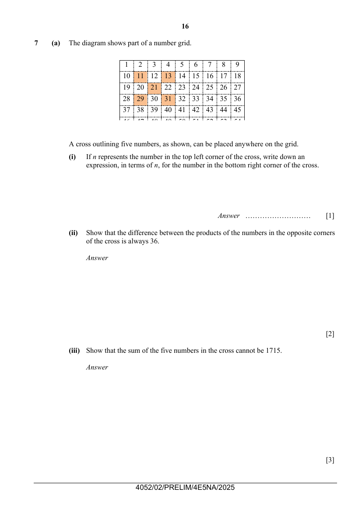

## Question

> **Marks:** (a)(i) 1, (a)(ii) 2, (a)(iii) 3, (b)(i) 1, (b)(ii) 2, (b)(iii) 1; total 10
> **Page:** 16–17

**(a)** The diagram shows part of a number grid.

A cross outlining five numbers, as shown, can be placed anywhere on the grid.

**(i)** If $n$ represents the number in the top left corner of the cross, write down an expression, in terms of $n$, for the number in the bottom right corner of the cross. [1]

**(ii)** Show that the difference between the products of the numbers in the opposite corners of the cross is always 36. [2]

**(iii)** Show that the sum of the five numbers in the cross cannot be 1715. [3]

**(b)** The $n$th term of a sequence is given by $T_{n}=2n^{2}-n+3$.

**(i)** Find the value of $T_{10}$. [1]

**(ii)** The difference, $D$, between two consecutive terms of the sequence is $T_{n+1}-T_{n}$.
Show that $D=kn+1$, where $k$ is an integer to be found. [2]

**(iii)** Using the expression from part (ii), explain, without doing any further calculation, how the difference between two consecutive terms of the sequence changes as $n$ increases by 1 each time. [1]

## Answer Scheme

**(a) (i)** $n+20$

**(ii)** Product of top left and bottom right $=n(n+20)=n^{2}+20n$

Product of top right and bottom left $=(n+2)(n+18)=n^{2}+20n+36$

Difference $=(n^{2}+20n+36)-(n^{2}+20n)=36$

**(iii)**

$$
\text{Sum}=n+(n+2)+(n+10)+(n+18)+(n+20)=5n+50
$$

Let $5n+50=1715\Rightarrow n=333$

If $n=333$, the cross will be $333\ldots 335$, $\ldots 343\ldots$, $351\ldots 353$.

However, $333=9\times 37$, the first number will be in the last column of the number grid, therefore, the sum cannot be 1715.

**(b) (i)**

$$
T_{10}=2(10)^{2}-10+3=193
$$

**(ii)**

$$
T_{n+1}=2(n+1)^{2}-(n+1)+3=2(n^{2}+2n+1)-n-1+3=2n^{2}+3n+4
$$

$$
D=(2n^{2}+3n+4)-(2n^{2}-n+3)=4n+1
$$

**(iii)** Since $D$ is a linear expression in $n$ and the coefficient of $n$ is 4, it means that the difference increases by 4 each time $n$ increases by 1.
