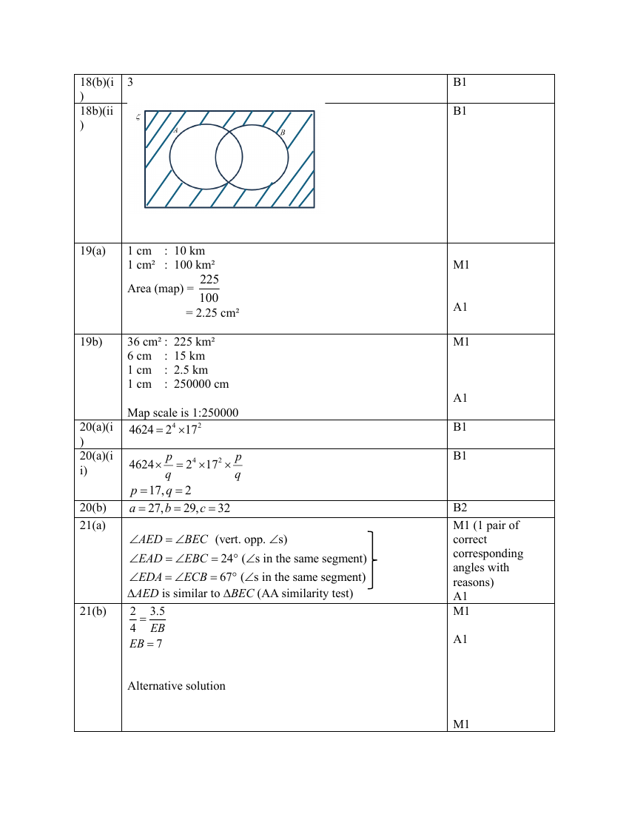

## Question

> **Marks:** (a) 2, (b)(i) 1, (b)(ii) 1; total 4
> **Page:** 16

**(a)** Mr Lim bought a refrigerator on hire purchase. The cash price of the refrigerator is &#36;1,200. He paid a $20\%$ deposit and agreed to pay the balance in 12 equal monthly instalments. Each instalment included an interest of $1.5\%$ per month on the unpaid balance.
Calculate the total amount paid for the refrigerator under hire purchase. [2]

**(b)**

**(i)** The Venn diagram shows the universal set and the number of elements in each of its subsets.
Find the number of element in the set $(A\cap B)\cup(A\cup B)'$. [1]

**(ii)** On the Venn diagram, shade the region which represents $(A'\cup B)\cap(A\cup B)'$. [1]

## Answer Scheme

**(a)**

$$
\text{Deposit}=\frac{20}{100}\times&#36;1200=&#36;240
$$

Remaining amount $=&#36;1200-&#36;240=&#36;960$

$$
\text{Monthly payment}=\frac{1.5}{100}\times&#36;960\times 12=&#36;172.80
$$

Total amount paid $=&#36;172.80+&#36;1200=&#36;1372.80$

**(b)(i)** $3$

**(b)(ii)** Shade the region outside both $A$ and $B$ only if that is the region required by $(A'\cup B)\cap(A\cup B)'$. The scheme mark is B1 on the diagram.

