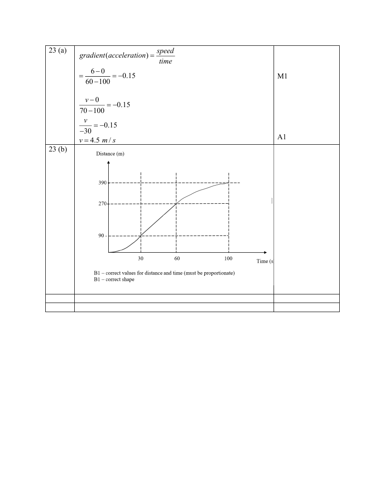

## Question

> **Marks:** (a) 2, (b) 2; total 4
> **Page:** 21

The diagram below shows part of the speed-time graph of Javier’s cycle journey. Javier travelled from the starting point to point $A$ in 100 seconds.

**(a)** Calculate Javier’s cycling speed at $t=70\text{s}$. [2]

**(b)** Sketch the corresponding distance-time graph on the axes below. [2]

---

**END OF PAPER**

## Answer Scheme

**(a)**

$$
\text{gradient (acceleration)}=\frac{\text{speed}}{\text{time}}=\frac{6-0}{60-100}=-0.15
$$

$$
\frac{v-0}{70-100}=-0.15
$$

$$
\frac{v}{-30}=-0.15
$$

$$
v=4.5\text{ m/s}
$$

**(b)** B1 — correct values for distance and time (must be proportionate). B1 — correct shape.

