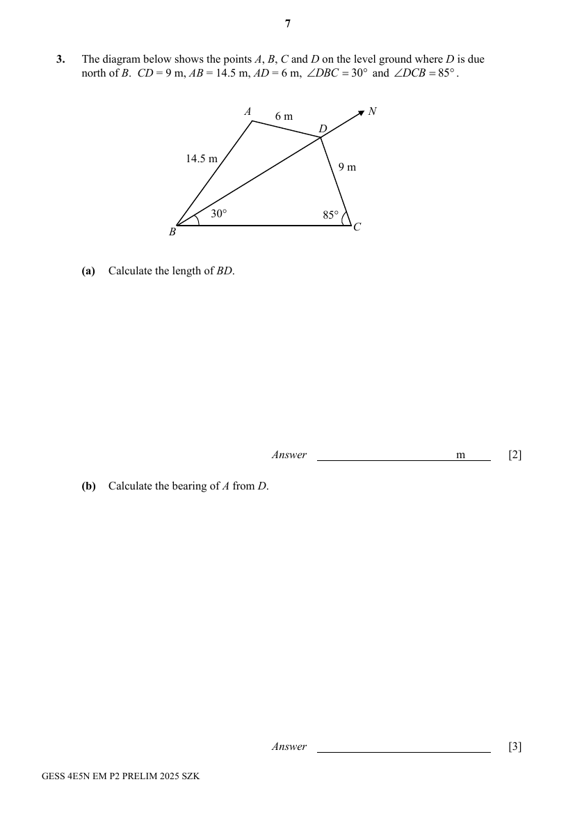

## Question

> **Marks:** (a) 2, (b) 3, (c) 3; total 8
> **Page:** 7–8

The diagram below shows the points $A$, $B$, $C$ and $D$ on the level ground where $D$ is due north of $B$. $CD=9\text{ m}$, $AB=14.5\text{ m}$, $AD=6\text{ m}$, $\angle DBC=30^{\circ}$ and $\angle DCB=85^{\circ}$.

**(a)** Calculate the length of $BD$. [2]

**(b)** Calculate the bearing of $A$ from $D$. [3]

**(c)** $CT$ is a vertical pole of height $12\text{ m}$ standing at $C$.
$X$ is a point along the path $BD$ such that the angle of elevation of the top of the pole, $T$, from $X$ is the greatest.

Find the angle of elevation of $T$ from $X$. [3]

## Answer Scheme

**(a)** By sine rule,

$$
\frac{BD}{\sin 85^{\circ}}=\frac{9}{\sin 30^{\circ}}
$$

$$
BD=17.9315\ (6\text{ s.f.})=17.9\text{ m}\ (3\text{ s.f.})
$$

**(b)**

$$
\cos\angle BDA=\frac{6^{2}+17.9315^{2}-14.5^{2}}{2(6)(17.9315)}=46.8039^{\circ}\ (4\text{ d.p.})
$$

$$
\text{Bearing}=180^{\circ}+46.8039^{\circ}=226.804^{\circ}=226.8^{\circ}
$$

**(c)** Note: the greatest angle of elevation/depression occurs at the shortest distance $CX$.

In triangle $DCX$,

$$
\sin 65^{\circ}=\frac{CX}{9}
$$

$$
CX=9\sin 65^{\circ}
$$

Let $\theta$ be the greatest angle of elevation.

$$
\tan\theta=\frac{12}{9\sin 65^{\circ}}
$$

$$
\theta=55.7948^{\circ}\ (4\text{ d.p.})=55.8^{\circ}\ (1\text{ d.p.})
$$

Students may use the area of the triangle to find $CX$.
