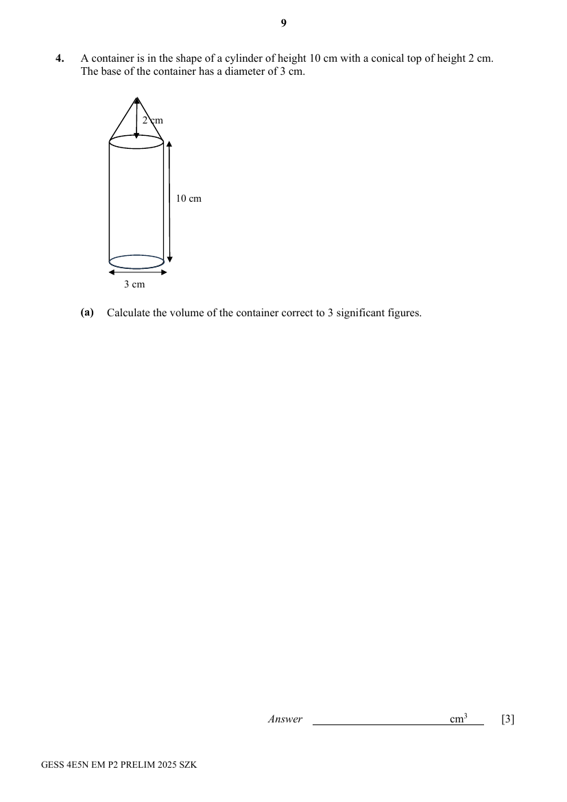
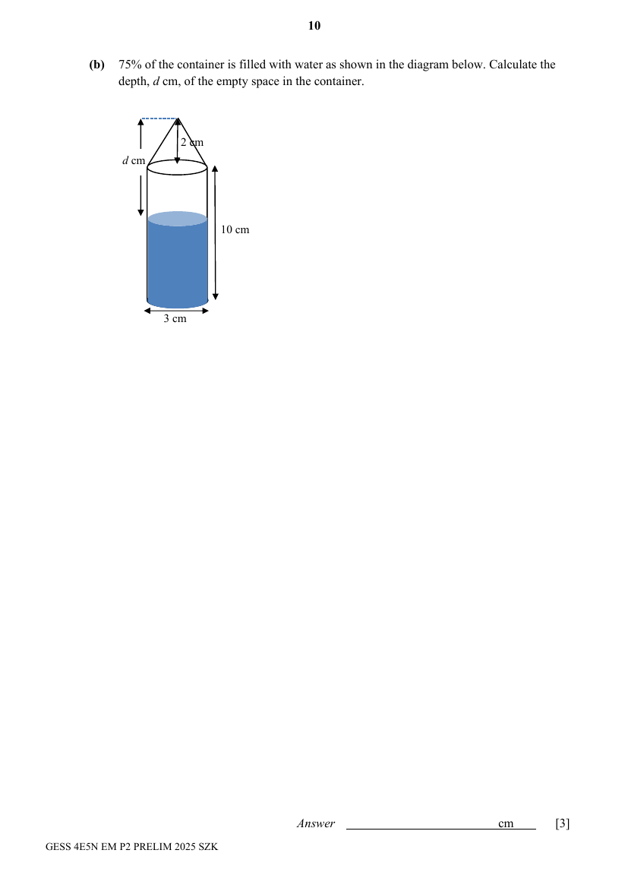

## Question

> **Marks:** (a) 3, (b) 3, (c) 2, (d) 1; total 9
> **Page:** 9–11

A container is in the shape of a cylinder of height $10\text{ cm}$ with a conical top of height $2\text{ cm}$.
The base of the container has a diameter of $3\text{ cm}$.

**(a)** Calculate the volume of the container correct to 3 significant figures. [3]

**(b)** $75\%$ of the container is filled with water as shown in the diagram below. Calculate the depth, $d\text{ cm}$, of the empty space in the container. [3]

All the liquid is transferred to fill up a pyramid with square based completely in $x$ minutes.

**(c)** Find the height of the pyramid if the side of the base is $4\text{ cm}$. [2]

**(d)** Find the time taken in terms of $x$, for the liquid to fill up to $\dfrac{1}{3}$ the height of the square pyramid in (c). [1]

## Answer Scheme

**(a)** M1, M1 for each working.

$$
\text{Vol. of container}=\pi(1.5)^{2}(10)+\frac{1}{2}\pi(1.5)^{2}(2)=75.3982\text{ cm}^{3}\ (4\text{ s.f.})=75.4\text{ cm}^{3}\ (3\text{ s.f.})
$$

**(b)**

$$
\text{Vol. of water}=\frac{75}{100}\times 75.3982=56.5487\ (4\text{ s.f.})
$$

$$
\text{Height of water}=\frac{56.5487}{\pi(1.5)^{2}}=8.00\text{ cm}
$$

$$
d=10+2-8.0000=4.00\ (3\text{ s.f.})
$$

**(c)** Let the height of the pyramid be $h$ cm.

$$
\frac{1}{3}\times 4\times 4\times h=56.5487
$$

$$
h=10.6029\ (6\text{ s.f.})=10.6\text{ cm}\ (3\text{ s.f.})
$$

**(d)**

$$
\text{Time}=\left[1-\left(\frac{2}{3}\right)^{3}\right]x=\frac{19}{27}x\text{ minutes}
$$

Accept $\dfrac{1}{27}x$ minutes (as students may see it in another perspective).
