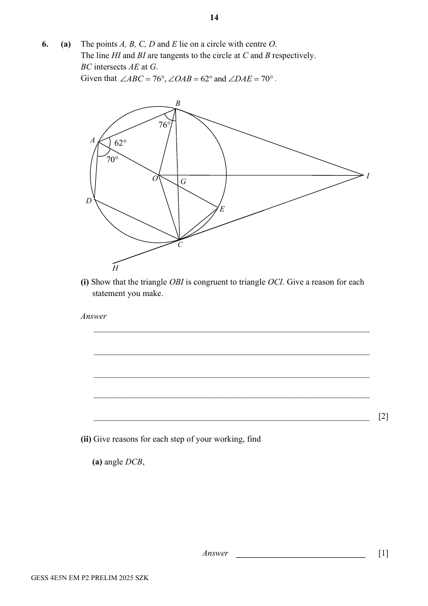
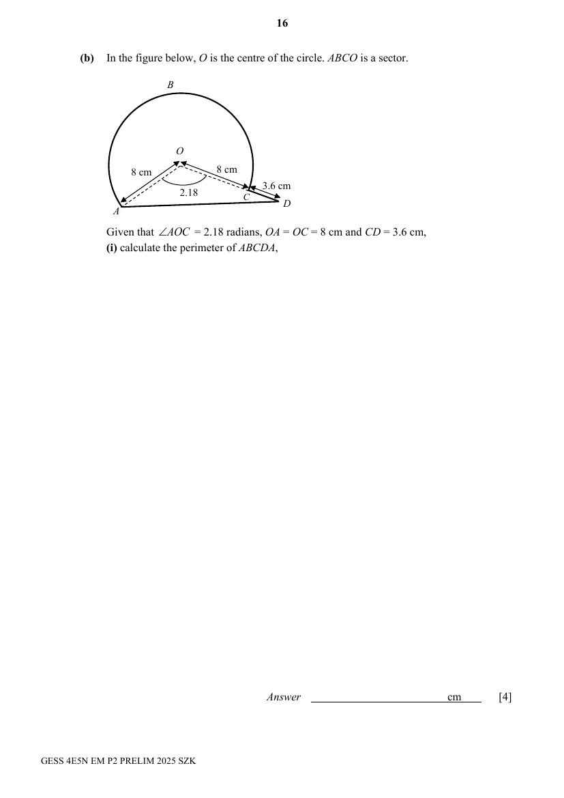

## Question

> **Marks:** (a)(i) 2, (a)(ii)(a) 1, (a)(ii)(b) 2, (a)(ii)(c) 1, (b)(i) 4, (b)(ii) 3; total 13
> **Page:** 14–17

**(a)** The points $A$, $B$, $C$, $D$ and $E$ lie on a circle with centre $O$.
The line $HI$ and $BI$ are tangents to the circle at $C$ and $B$ respectively.
$BC$ intersects $AE$ at $G$.
Given that $\angle ABC=76^{\circ}$, $\angle OAB=62^{\circ}$ and $\angle DAE=70^{\circ}$.

**(i)** Show that the triangle $OBI$ is congruent to triangle $OCI$. Give a reason for each statement you make. [2]

**(ii)** Give reasons for each step of your working, find

**(a)** angle $DCB$, [1]

**(b)** angle $GCO$, [2]

**(c)** angle $BCH$. [1]

**(b)** In the figure below, $O$ is the centre of the circle. $ABCO$ is a sector.

Given that $\angle AOC=2.18$ radians, $OA=OC=8\text{ cm}$ and $CD=3.6\text{ cm}$,

**(i)** calculate the perimeter of $ABCDA$, [4]

**(ii)** find the value of $\dfrac{\text{area of sector }ABCO}{\text{area of triangle }AOD}$.
Give your answer correct to 2 decimal places. [3]

## Answer Scheme

**(a)(i)**

$\angle OBI=90^{\circ}$ (tan perpendicular rad)

$\angle OCI=90^{\circ}$ (tan perpendicular rad)

$OI$ is a common line.

$OB=OC$ (radii of the same circle)

By RHS, triangle $OBI$ is congruent to triangle $OCI$.

**(a)(ii)(a)**

$$
\angle DCB=180-(62+70)=48^{\circ}
$$

(angle in opposite segment)

**(a)(ii)(b)**

$$
\angle GCE=\angle GAB=62^{\circ}
$$

(angle in the same segment)

$OC=OE$ (radii of the same circle)

$$
\angle OCE=\angle OEC=76^{\circ}
$$

(base of isosceles triangle)

$$
\angle GOC=76-62=14^{\circ}
$$

Accepts other methods (e.g. find angle $OBC$ first).

**(a)(ii)(c)**

$$
\angle OCH=90^{\circ}
$$

(tan perpendicular rad)

$$
\angle BCH=90+14=104^{\circ}
$$

**(b)(i)**

$$
\text{Major arc length}=(2\pi-2.18)\times 8=16\pi-17.44
$$

$$
AD^{2}=8^{2}+(8+3.6)^{2}-2(8)(8+3.6)\cos 2.18
$$

$$
AD=17.4575\ (6\text{ s.f.})
$$

$$
\text{Perimeter}=16\pi-17.44+3.6+17.4575=53.9\text{ cm}\ (3\text{ s.f.})
$$

**(b)(ii)**

$$
\frac{\text{area of sector }ABCO}{\text{area of triangle }AOD}=\frac{\frac{1}{2}\times(8)^{2}\times(2\pi-2.18)}{\frac{1}{2}\times(8)\times(8+3.6)\sin 2.18}=3.45052\ (5\text{ d.p.})=3.45\ (2\text{ d.p.})
$$
