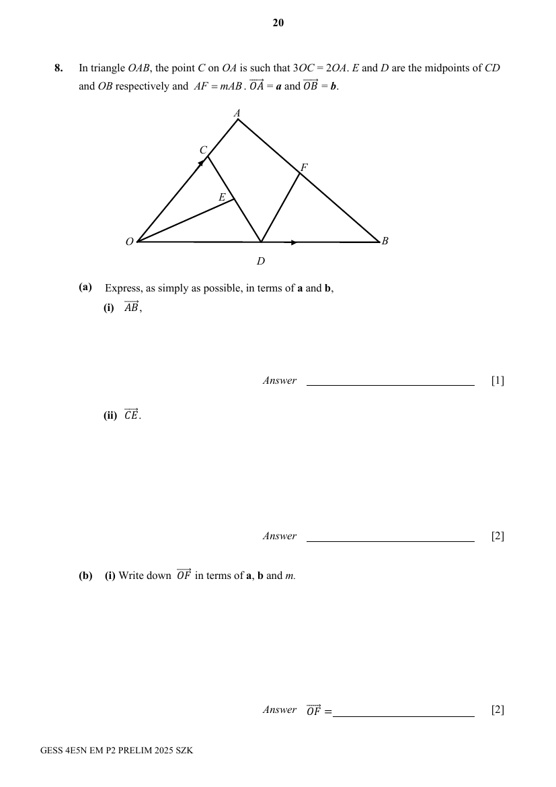

## Question

> **Marks:** (a)(i) 1, (a)(ii) 2, (b)(i) 2, (b)(ii) 2, (c)(i) 1, (c)(ii) 1; total 9
> **Page:** 20–21

In triangle $OAB$, the point $C$ on $OA$ is such that $3OC=2OA$. $E$ and $D$ are the midpoints of $CD$ and $OB$ respectively and $AF=mAB$. $\overrightarrow{OA}=\mathbf{a}$ and $\overrightarrow{OB}=\mathbf{b}$.

**(a)** Express, as simply as possible, in terms of $\mathbf{a}$ and $\mathbf{b}$,

**(i)** $\overrightarrow{AB}$, [1]

**(ii)** $\overrightarrow{CE}$. [2]

**(b)**

**(i)** Write down $\overrightarrow{OF}$ in terms of $\mathbf{a}$, $\mathbf{b}$ and $m$. [2]

**(ii)** $\overrightarrow{OE}=\dfrac{3}{5}(1-m)\mathbf{a}+\dfrac{3}{5}m\mathbf{b}$.
Show that $O$, $E$ and $F$ lie on a straight line. [2]

**(c)** Find, as a fraction in its simplest form,

**(i)** $\dfrac{\text{area of triangle }AEC}{\text{area of triangle }OEC}$, [1]

**(ii)** $\dfrac{\text{area of triangle }OCD}{\text{area of triangle }OAB}$. [1]

## Answer Scheme

**(a)(i)** $-\mathbf{a}+\mathbf{b}$

**(a)(ii)**

$$
\overrightarrow{CD}=\overrightarrow{CO}+\overrightarrow{OD}=\frac{2}{3}(-\mathbf{a})+\frac{1}{2}(\mathbf{b})=-\frac{2}{3}\mathbf{a}+\frac{1}{2}\mathbf{b}
$$

$$
\overrightarrow{CE}=\frac{1}{2}\left(-\frac{2}{3}\mathbf{a}+\frac{1}{2}\mathbf{b}\right)=-\frac{1}{3}\mathbf{a}+\frac{1}{4}\mathbf{b}
$$

**(b)(i)**

$$
\overrightarrow{OF}=\overrightarrow{OA}+\overrightarrow{AF}=\mathbf{a}+m(-\mathbf{a}+\mathbf{b})=(1-m)\mathbf{a}+m\mathbf{b}
$$

**(b)(ii)**

$$
\overrightarrow{OE}=\frac{3}{5}\overrightarrow{OF}
$$

Since $\overrightarrow{OE}$ is a scalar multiple of $\overrightarrow{OF}$ and there is a common point $O$, $O$, $E$ and $F$ lie on a straight line.

**(c)(i)**

$$
\frac{\text{area of triangle }AEC}{\text{area of triangle }OEC}=\frac{\frac{1}{2}\times 1\times h}{\frac{1}{2}\times 2\times h}=\frac{1}{2}
$$

**(c)(ii)**

$$
\frac{\text{area of triangle }OCD}{\text{area of triangle }OAB}=\frac{\text{area of triangle }OCD}{\text{area of triangle }OAD}\times\frac{\text{area of triangle }OAD}{\text{area of triangle }OAB}=\frac{2}{3}\times\frac{1}{2}=\frac{1}{3}
$$

Accepts other methods.
