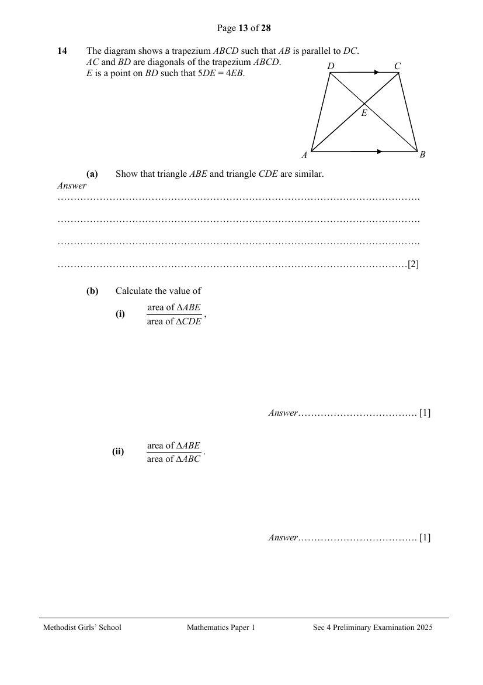

## Question

> **Marks:** (a) 2, (b)(i) 1, (b)(ii) 1; total 4
> **Page:** 13

The diagram shows a trapezium $ABCD$ such that $AB$ is parallel to $DC$.
$AC$ and $BD$ are diagonals of the trapezium $ABCD$.
$E$ is a point on $BD$ such that $5DE=4EB$.

**(a)** Show that triangle $ABE$ and triangle $CDE$ are similar. [2]

**(b)** Calculate the value of

**(i)** $\dfrac{\text{area of }\triangle ABE}{\text{area of }\triangle CDE}$, [1]

**(ii)** $\dfrac{\text{area of }\triangle ABE}{\text{area of }\triangle ABC}$. [1]

## Answer Scheme

The diagram shows a trapezium $ABCD$ such that $AB$ is parallel to $DC$.
$AC$ and $BD$ are diagonals of the trapezium $ABCD$.
$E$ is a point on $BD$ such that $5DE=4EB$.

**(a)** Show that triangle $ABE$ and triangle $CDE$ are similar.

In $\triangle ABE$ and $\triangle CDE$,

$\angle EAB=\angle ECD$ (alt. $\angle$s)

$\angle AEB=\angle CED$ (vert. opp. $\angle$s)

$\therefore\triangle ABE$ is similar to $\triangle CDE$. (AA similarity test) [2]

**(b)**

**(i)**

$$
\frac{\text{area of }\triangle ABE}{\text{area of }\triangle CDE}=\left(\frac{5}{4}\right)^{2}=\frac{25}{16}
$$

A1

**(ii)**

$$
\frac{\text{area of }\triangle ABE}{\text{area of }\triangle ABC}=\frac{5}{9}
$$

A1
