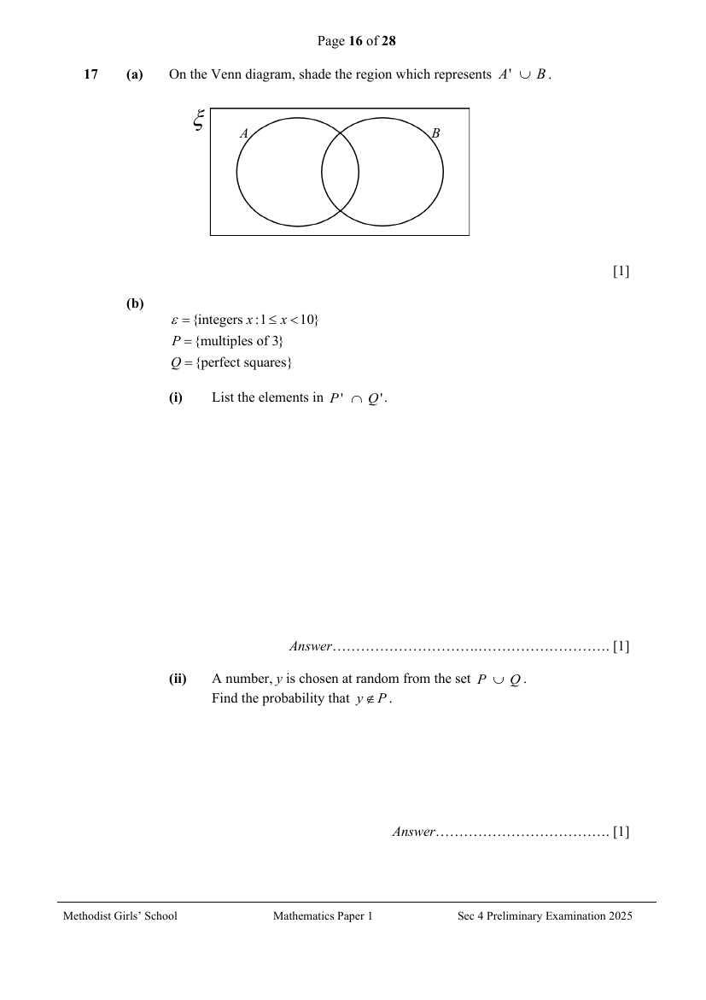

## Question

> **Marks:** (a) 1, (b)(i) 1, (b)(ii) 1; total 3
> **Page:** 16

**(a)** On the Venn diagram, shade the region which represents $A'\cup B$. [1]

**(b)**

$\varepsilon=\{\text{integers }x:1\leq x<10\}$

$P=\{\text{multiples of }3\}$

$Q=\{\text{perfect squares}\}$

**(i)** List the elements in $P'\cap Q'$. [1]

**(ii)** A number, $y$ is chosen at random from the set $P\cup Q$.
Find the probability that $y\notin P$. [1]

## Answer Scheme

**(a)** On the Venn diagram, shade the region which represents $A'\cup B$.

**(b)**

$\varepsilon=\{\text{integers }x:1\leq x<10\}$

$P=\{\text{multiples of }3\}$

$Q=\{\text{perfect squares}\}$

**(i)** List the elements in $P'\cap Q'$.

$$
\begin{aligned}
\varepsilon&=\{1,2,3,4,5,6,7,8,9\}\\
P&=\{3,6,9\},\quad P'=\{1,2,4,5,7,8\}\\
Q&=\{1,4,9\},\quad Q'=\{2,3,5,6,7,8\}\\
P'\cap Q'&=\{2,5,7,8\}
\end{aligned}
$$

A1

**(ii)** A number, $y$ is chosen at random from the set $P\cup Q$.
Find the probability that $y\notin P$.

$$
\frac{2}{5}
$$

A1
