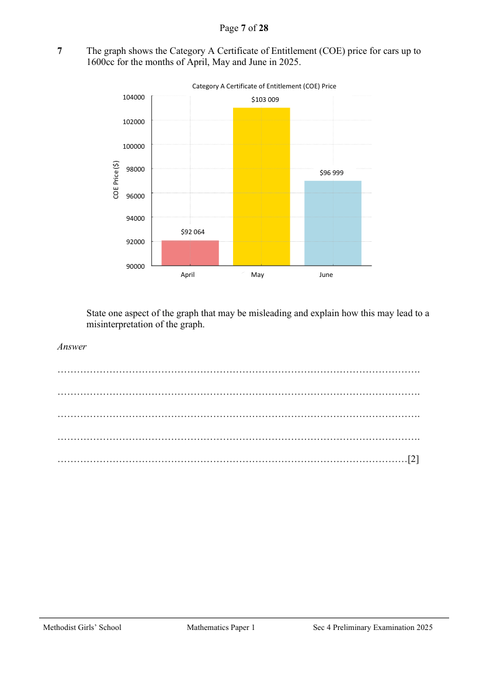

## Question

> **Marks:** 2
> **Page:** 7

The graph shows the Category A Certificate of Entitlement (COE) price for cars up to 1600cc for the months of April, May and June in 2025.

State one aspect of the graph that may be misleading and explain how this may lead to a misinterpretation of the graph. [2]

## Answer Scheme

The graph shows the Category A Certificate of Entitlement (COE) price for cars up to 1600cc for the months of April, May and June in 2025.

State one aspect of the graph that maybe misleading and explain how this may lead to a misinterpretation of the graph.

By starting the vertical axis at &#36;90000 and not at zero, it exaggerates small differences in COE prices, making the COE price of May look dramatically more expensive than April or June, even though the actual difference is relatively small. [2]
