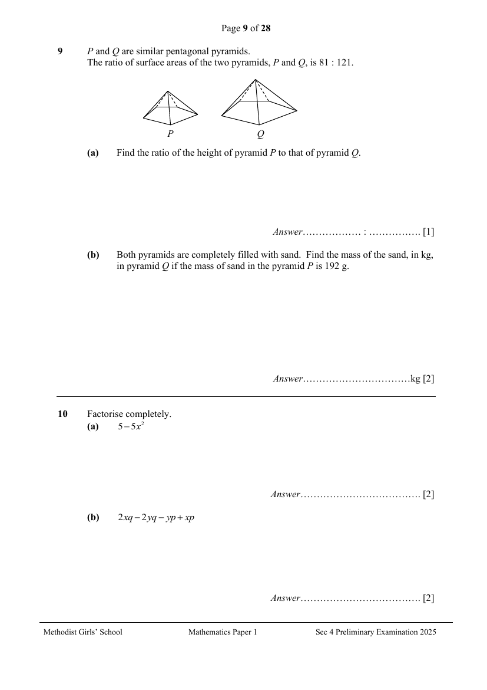

## Question

> **Marks:** (a) 1, (b) 2; total 3
> **Page:** 9

$P$ and $Q$ are similar pentagonal pyramids.
The ratio of surface areas of the two pyramids, $P$ and $Q$, is $81:121$.

**(a)** Find the ratio of the height of pyramid $P$ to that of pyramid $Q$. [1]

**(b)** Both pyramids are completely filled with sand. Find the mass of the sand, in kg, in pyramid $Q$ if the mass of sand in the pyramid $P$ is $192$ g. [2]

## Answer Scheme

$P$ and $Q$ are similar pentagonal pyramids.
The ratio of surface areas of the two pyramids, $P$ and $Q$, is $81:121$.

**(a)** Find the ratio of the height of pyramid $P$ to that of pyramid $Q$.

$$
\text{Height }P:\text{Height }Q=\sqrt{81}:\sqrt{121}=9:11
$$

A1

**(b)** Both pyramids are completely filled with sand. Find the mass of the sand, in kg, in pyramid $Q$ if the mass of sand in the pyramid $P$ is $192$ g.

$$
\frac{0.192}{M_{Q}}=\frac{9^{3}}{11^{3}}
$$

M1

$$
M_{Q}=\frac{11^{3}\times 0.192}{9^{3}}=0.35055=0.351\text{ kg (3 s.f.)}
$$

A1
