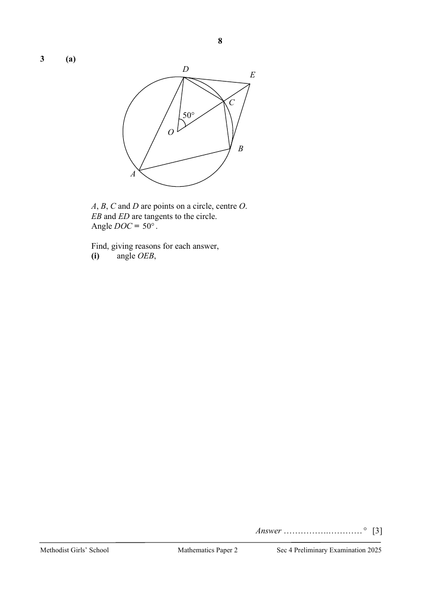
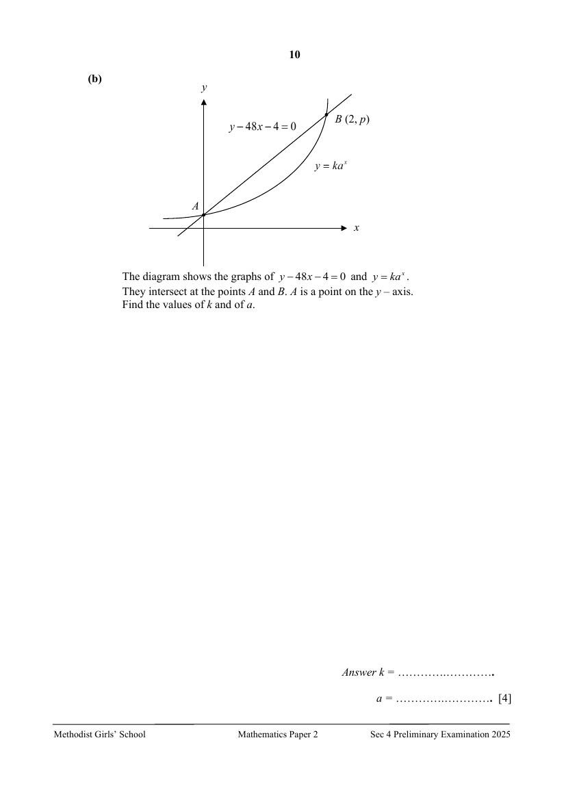
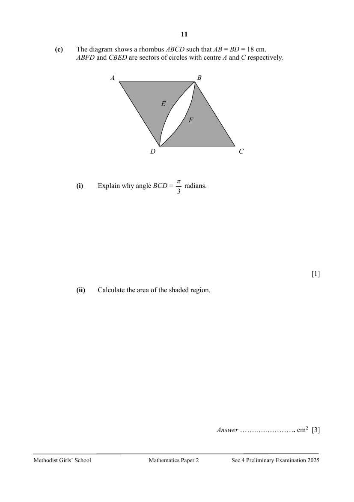

## Question

> **Marks:** (a)(i) 3, (a)(ii) 2, (a)(iii) 1, (b) 4, (c)(i) 1, (c)(ii) 3; total 14
> **Page:** 8–11

**(a)** $A$, $B$, $C$ and $D$ are points on a circle, centre $O$.
$EB$ and $ED$ are tangents to the circle.
Angle $DOC=50^{\circ}$.

Find, giving reasons for each answer,

**(i)** angle $OEB$, [3]

**(ii)** angle $DAB$, [2]

**(iii)** angle $EBC$. [1]

**(b)** The diagram shows the graphs of $y-48x-4=0$ and $y=ka^{x}$.
They intersect at the points $A$ and $B$. $A$ is a point on the $y$-axis.
Find the values of $k$ and of $a$. [4]

**(c)** The diagram shows a rhombus $ABCD$ such that $AB=BD=18$ cm.
$ABFD$ and $CBED$ are sectors of circles with centre $A$ and $C$ respectively.

**(i)** Explain why angle $BCD=\dfrac{\pi}{3}$ radians. [1]

**(ii)** Calculate the area of the shaded region. [3]

## Answer Scheme

**(a) (i)** angle $OEB$

$\angle ODE=90^{\circ}$ (tan $\perp$ rad) M1

$$
\angle DEO=180^{\circ}-90^{\circ}-50^{\circ}
$$

($\angle$ sum in a $\triangle$) M1

$$
=40^{\circ}
$$

$\angle OEB=40^{\circ}$ (tangents from ext. point) A1

**(ii)** angle $DAB$

$\angle COB=50^{\circ}$ (tangents from ext. pt) M1

$\angle DOB=100^{\circ}$

$\angle DAB=50^{\circ}$ ($\angle$ at centre $=2\times\angle$ at circumference) A1

**(iii)** angle $EBC$

$$
\angle OBC=\frac{180^{\circ}-50^{\circ}}{2}=65^{\circ}
$$

(base $\angle$s of isosceles $\triangle$)

$$
\angle EBC=90^{\circ}-65^{\circ}=25^{\circ}
$$

B1

**(b)**

$$
y-48x-4=0
$$

When $x=0$, $y=4$. M1

$A(0,4)$

When $x=2$, $p=100$.

$B(2,100)$ M1

$$
y=ka^{x}
$$

When $x=0$, $y=4=ka^{0}$, so $k=4$. A1

When $x=2$, $y=100=4a^{2}$, so $a=5$. A1

**(c) (i)** Explain why angle $BCD=\dfrac{\pi}{3}$ radians.

$AB=BC=DC$ (sides of rhombus)

$AB=BD$ (given)

$BC=BD$

Triangle $BCD$ is an equilateral triangle. B1

$$
\angle BCD=\frac{\pi}{3}\text{ radians}
$$

**(ii)** Calculate the area of the shaded region.

Area of rhombus

$$
=2\left[\frac{1}{2}(18)^{2}\sin\frac{\pi}{3}\right]=290.59\text{ (5 s.f.)}
$$

M1

Shaded area

$$
=2\times\left[290.59-\frac{1}{2}(18)^{2}\frac{\pi}{3}\right]=222\text{ cm}^{2}\text{ (3 s.f.)}
$$

M1, A1
