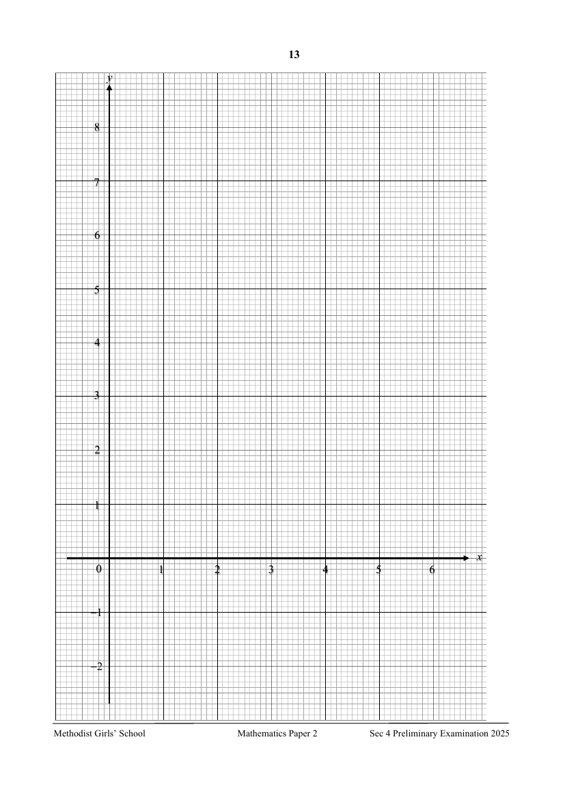

## Question

> **Marks:** (a) 1, (b) 3, (c) 2, (d)(i) 2, (d)(ii) 1, (d)(iii) 3; total 12
> **Page:** 12–13

**(a)** Complete the table of values for $y=\dfrac{x^{2}}{3}+\dfrac{3}{x}-4$.
Values are given to two decimal places where appropriate. [1]

| $x$ | $0.5$ | $1$ | $1.5$ | $2$ | $3$ | $4$ | $5$ | $6$ |
| --- | --- | --- | --- | --- | --- | --- | --- | --- |
| $y$ | $2.08$ | $-0.67$ | $-1.25$ |  | $0$ | $2.08$ | $4.93$ | $8.5$ |

**(b)** On the grid opposite, draw the graph of $y=\dfrac{x^{2}}{3}+\dfrac{3}{x}-4$ for $0.5\leq x\leq 6$. [3]

**(c)** By drawing a tangent, find the gradient of the curve at $(3,0)$. [2]

**(d)**

**(i)** On the same axes, draw the line with gradient $\dfrac{4}{3}$ that passes through $(3,2)$. [2]

**(ii)** Write down the $x$-coordinate(s) of the point(s) where the line intersects the curve. [1]

**(iii)** The $x$-coordinate(s) of the point(s) of intersection satisfy the equation $x^{3}+Ax^{2}+Bx+C=0$.
Find the values of $A$, $B$ and $C$. [3]

## Answer Scheme

**(a)** Complete the table of values for $y=\dfrac{x^{2}}{3}+\dfrac{3}{x}-4$.

| $x$ | $0.5$ | $1$ | $1.5$ | $2$ | $3$ | $4$ | $5$ | $6$ |
| --- | --- | --- | --- | --- | --- | --- | --- | --- |
| $y$ | $2.08$ | $-0.67$ | $-1.25$ | $-1.17$ | $0$ | $2.08$ | $4.93$ | $8.5$ |

B1 for $-1.17$

**(b)** On the grid opposite, draw the graph of $y=\dfrac{x^{2}}{3}+\dfrac{3}{x}-4$ for $0.5\leq x\leq 6$. [3]

**(c)** By drawing a tangent, find the gradient of the curve at $(3,0)$.

Correct tangent drawn. M1

$1.65$, accept $1.32$ to $1.98$. A1

**(d) (i)** On the same axes, draw the line with gradient $\dfrac{4}{3}$ that passes through $(3,2)$.

Gradient of $\dfrac{4}{3}$. B1

Passes through $(3,2)$. B1

**(ii)** Write down the $x$-coordinate(s) of the point(s) where the line intersects the curve.

$1\pm 0.1$, $4.85\pm 0.1$ B1

**(iii)**

$$
y=\frac{x^{2}}{3}+\frac{3}{x}-4
$$

$$
y=\frac{4}{3}x-2
$$

$$
\frac{x^{2}}{3}+\frac{3}{x}-4=\frac{4}{3}x-2
$$

M1

$$
x^{3}+9-12x=4x^{2}-6x
$$

$$
x^{3}-4x^{2}-6x+9=0
$$

M1

$A=-4$, $B=-6$, $C=9$ A1
