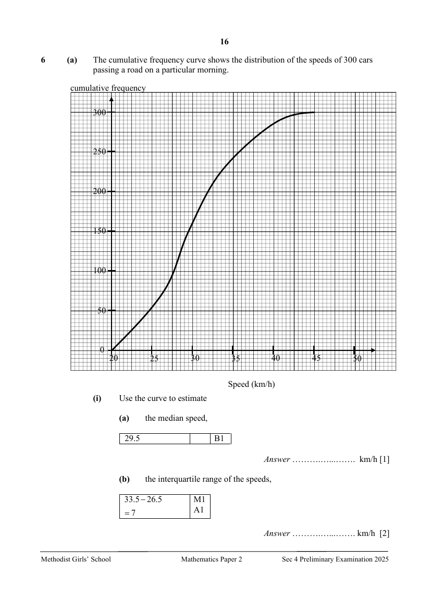

## Question

> **Marks:** (a)(i)(a) 1, (a)(i)(b) 2, (a)(i)(c) 1, (a)(ii) 1, (a)(iii) 2, (b)(i) 1, (b)(ii) 2, (b)(iii) 1; total 11
> **Page:** 16–18

**(a)** The cumulative frequency curve shows the distribution of the speeds of 300 cars passing a road on a particular morning.

**(i)** Use the curve to estimate

**(a)** the median speed, [1]

**(b)** the interquartile range of the speeds, [2]

**(c)** 70th percentile. [1]

**(ii)** Given that $10\%$ of the cars have a speed of more than $p$ km/h, find the value of $p$. [1]

**(iii)** The speeds of 300 cars passing the same road in the afternoon were also recorded.
The box-and-whiskers plot shows the distribution of the speeds, in km/h.

Make two comments comparing the speeds of the cars in the morning and in the afternoon. [2]

**(b)** Ten identical cards are labelled 1, 2, 3, 4, 5, 6, 7, 8, 9 and 10 respectively.
Two cards are drawn at random, one after the other, without replacement.
Find the probability that

**(i)** both cards picked have a number that is odd, [1]

**(ii)** one card picked has a number that is odd and the other card has a number that is even, [2]

**(iii)** the product of the numbers on both cards is even. [1]

## Answer Scheme

**(a) (i) (a)** the median speed

$29.5$ B1

**(b)** the interquartile range of the speeds

$$
33.5-26.5=7
$$

M1, A1

**(c)** 70th percentile

$32.5$ B1

**(ii)** $p=38$ B1

**(iii)**

Median speed in the morning $=29.5$ km/h

Median speed in the afternoon $=38$ km/h

The cars in the morning travel at a lower speed as the median speed in the lower in the morning. B1

Interquartile range in the morning $=7$ km/h

Interquartile range in the afternoon $=15$ km/h

The speeds of the cars in the morning are more consistent as the interquartile range in the morning is smaller. B1

**(b)**

**(i)**

$$
\frac{5}{10}\times\frac{4}{9}=\frac{2}{9}
$$

B1

**(ii)**

$$
\frac{5}{10}\times\frac{5}{9}\times 2=\frac{5}{9}
$$

M1, A1

**(iii)**

$$
1-\frac{2}{9}=\frac{7}{9}
$$

B1
