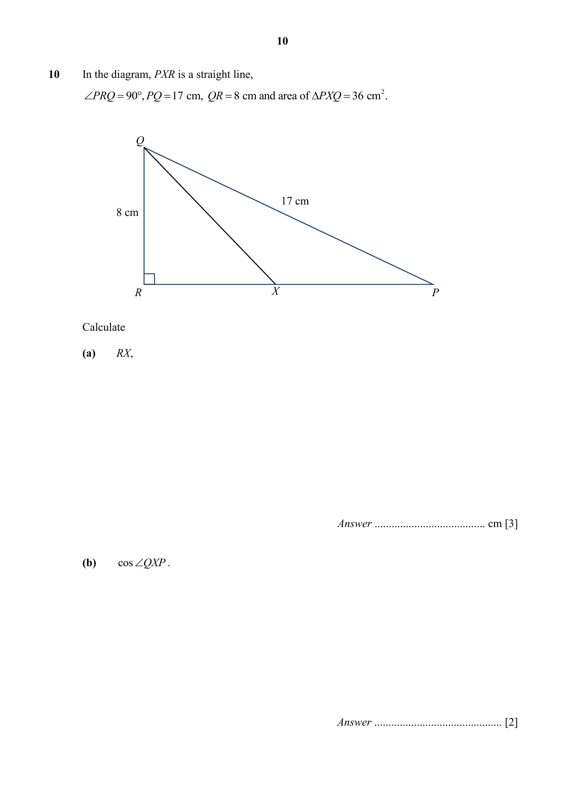

## Question

> **Marks:** (a) 3, (b) 2; total 5
> **Page:** 10

In the diagram, $PXR$ is a straight line,
$\angle PRQ = 90^{\circ}$, $PQ = 17\text{ cm}$, $QR = 8\text{ cm}$ and area of $\triangle PXQ = 36\text{ cm}^{2}$.

Calculate

**(a)** $RX$, [3]

**(b)** $\cos\angle QXP$. [2]

## Answer Scheme

In the diagram, $PXR$ is a straight line, $\angle PRQ=90^{\circ}$, $PQ=17$ cm, $QR=8$ cm and area of $\triangle PXQ=36\text{ cm}^{2}$.

**(a)** Calculate $RX$,

$$\frac{1}{2}(PX)(8)=36$$

$$PX=9$$

$$RP=\sqrt{17^{2}-8^{2}}$$

$$RP=15$$

$$RX=15-9$$

$$RX=6\text{ cm}$$

> **Markers Report:** Well done

**(b)** $\cos\angle QXP$.

$$\cos\angle QXP=-\frac{6}{\sqrt{8^{2}+6^{2}}}=-\frac{6}{10}=-\frac{3}{5}$$

> **Markers Report:** Many omitted the negative sign
