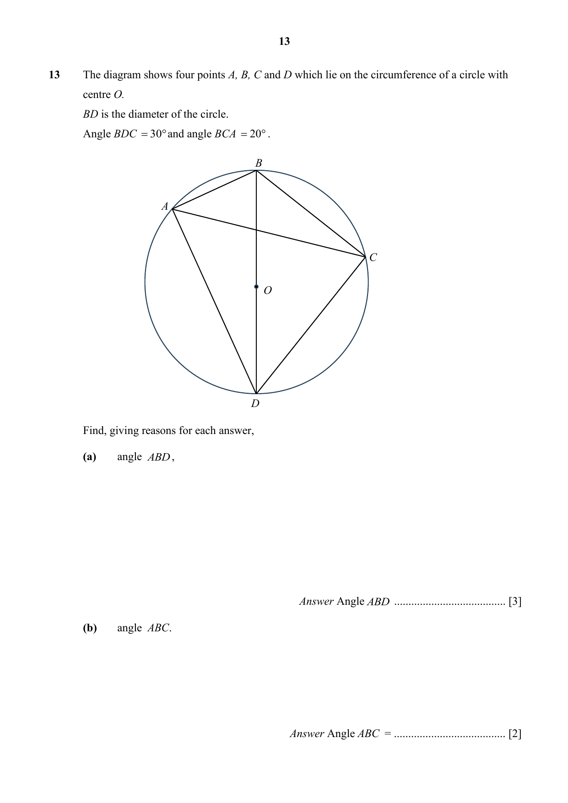

## Question

> **Marks:** (a) 3, (b) 2; total 5
> **Page:** 13

The diagram shows four points $A$, $B$, $C$ and $D$ which lie on the circumference of a circle with centre $O$.
$BD$ is the diameter of the circle.
Angle $BDC = 30^{\circ}$ and angle $BCA = 20^{\circ}$.

Find, giving reasons for each answer,

**(a)** angle $ABD$, [3]

**(b)** angle $ABC$. [2]

## Answer Scheme

The diagram shows four points $A$, $B$, $C$ and $D$ which lie on the circumference of a circle with centre $O$. $BD$ is the diameter of the circle. Angle $BDC=30^{\circ}$ and angle $BCA=20^{\circ}$.

Find, giving reasons for each answer,

**(a)** angle $ABD$,

$$\angle BAD=90^{\circ}\text{ (rt angle in semi-circle)}$$

$$\angle BDA=20^{\circ}\text{ (angles in same segment)}$$

$$\angle ABD=180^{\circ}-90^{\circ}-20^{\circ}\text{ (angle sum of triangle)}=70^{\circ}$$

> **Markers Report:** It was noted that a lot of students do not memorize the correct angle property.

**(b)** angle $ABC$.

$$\angle ABC=180^{\circ}-30^{\circ}-20^{\circ}\text{ (angles in opposite segment)}=130^{\circ}$$

> **Markers Report:** All other methods also accepted.
