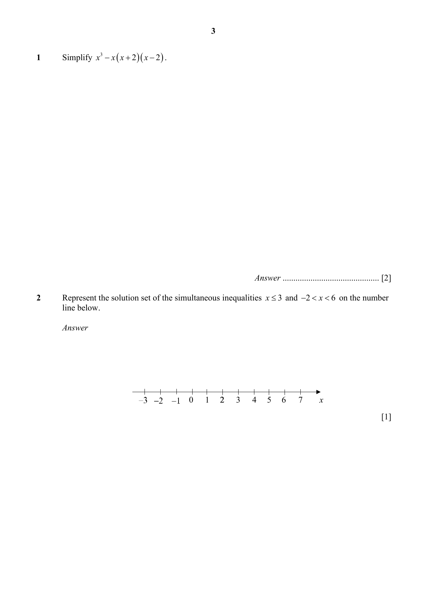

## Question

> **Marks:** 1
> **Page:** 3

Represent the solution set of the simultaneous inequalities $x \leq 3$ and $-2 < x < 6$ on the number line below. [1]

## Answer Scheme

Represent the solution set of the simultaneous inequalities $x\leq 3$ and $-2<x<6$ on the number line below.

$$-2<x\leq 3$$

> **Markers Report:** Well done but some did not draw final number line (shading alone not accepted)
