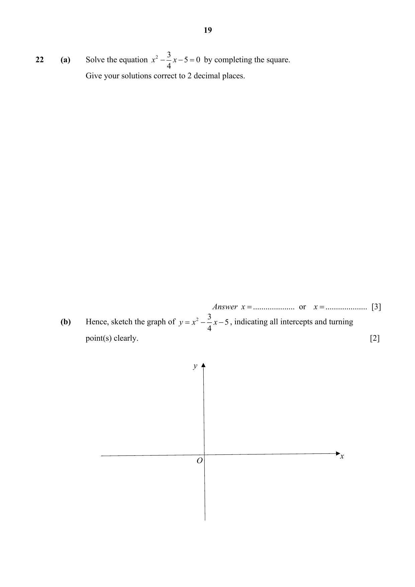

## Question

> **Marks:** (a) 3, (b) 2; total 5
> **Page:** 19

**(a)** Solve the equation $x^{2}-\dfrac{3}{4}x-5 = 0$ by completing the square.
Give your solutions correct to 2 decimal places. [3]

**(b)** Hence, sketch the graph of $y = x^{2}-\dfrac{3}{4}x-5$, indicating all intercepts and turning point(s) clearly. [2]

## Answer Scheme

**(a)** Solve the equation $x^{2}-\dfrac{3}{4}x-5=0$ by completing the square. Give your solutions correct to 2 decimal places.

$$x^{2}-\frac{3}{4}x-5=0$$

$$x^{2}-\frac{3}{4}x+\left(\frac{3}{8}\right)^{2}=5+\left(\frac{3}{8}\right)^{2}$$

$$\left(x-\frac{3}{8}\right)^{2}=\frac{329}{64}$$

$$x=\pm\sqrt{\frac{329}{64}}+\frac{3}{8}$$

$$x=2.64\text{ or }x=-1.89$$

> **Markers Report:** No marks for using quadratic formula

**(b)** Hence, sketch the graph of $y=x^{2}-\dfrac{3}{4}x-5$, indicating all intercepts and turning point(s) clearly. [2]

Intercepts labelled $-1.89$, $2.64$ and $-5$. Turning point $\left(\dfrac{3}{8},-5\dfrac{9}{64}\right)$.

> **Markers Report:** Should indicate all critical points
