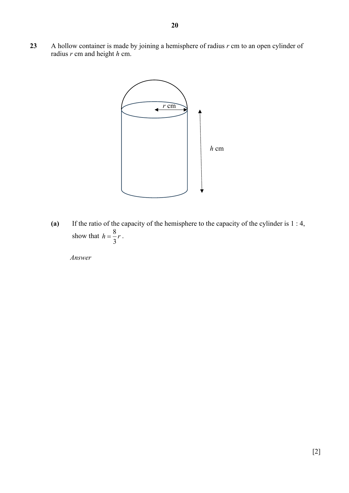

## Question

> **Marks:** (a) 2, (b) 2, (c) 2; total 6
> **Page:** 20–21

A hollow container is made by joining a hemisphere of radius $r$ cm to an open cylinder of radius $r$ cm and height $h$ cm.

**(a)** If the ratio of the capacity of the hemisphere to the capacity of the cylinder is $1:4$, show that $h = \dfrac{8}{3}r$. [2]

**(b)** If the total capacity of the container is $\dfrac{80\pi}{3}\text{ cm}^{3}$, find the radius. [2]

**(c)** Find the area of the metal sheet used to make the container.
Leave your answer in terms of $\pi$. [2]

## Answer Scheme

A hollow container is made by joining a hemisphere of radius $r$ cm to an open cylinder of radius $r$ cm and height $h$ cm.

**(a)** If the ratio of the capacity of the hemisphere to the capacity of the cylinder is $1:4$, show that $h=\dfrac{8}{3}r$.

$$\frac{\dfrac{2}{3}\pi r^{3}}{\pi r^{2}h}=\frac{1}{4}$$

$$\frac{\dfrac{2}{3}\pi r}{h}=\frac{1}{4}$$

$$\frac{2}{3}r=\frac{1}{4}h$$

$$h=\frac{8r}{3}\text{ (shown)}$$

> **Markers Report:** Well done

**(b)** If the total capacity of the container is $\dfrac{80\pi}{3}\text{ cm}^{3}$, find the radius.

$$\frac{2}{3}\pi r^{3}+\pi r^{2}h=\frac{80\pi}{3}$$

$$\frac{2}{3}\pi r^{3}+\pi r^{2}\left(\frac{8r}{3}\right)=\frac{80\pi}{3}$$

$$2r^{3}+8r^{3}=80$$

$$10r^{3}=80$$

$$r^{3}=8$$

$$r=2$$

> **Markers Report:** Generally well done though some used area instead.

**(c)** Find the area of the metal sheet used to make the container. Leave your answer in terms of $\pi$.

$$2\pi r^{2}+2\pi rh$$

Subt $r=2$

$$2\pi(2)^{2}+2\pi(2)h$$

$$=8\pi+\pi(4)\times\frac{16}{3}$$

$$=29\frac{1}{3}\pi$$

> **Markers Report:** Answer must be exact.
