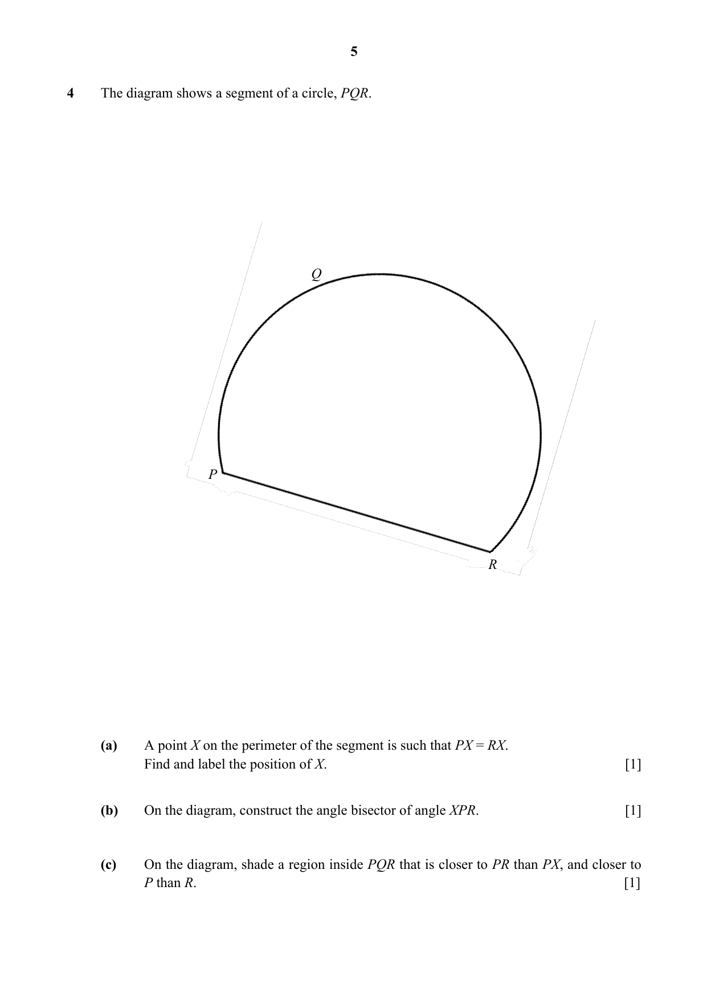
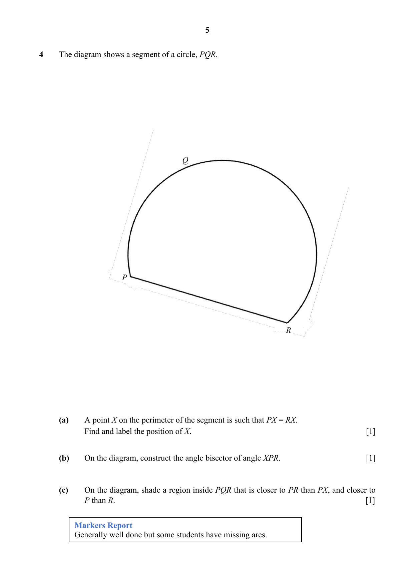

## Question

> **Marks:** (a) 1, (b) 1, (c) 1; total 3
> **Page:** 5

The diagram shows a segment of a circle, $PQR$.

**(a)** A point $X$ on the perimeter of the segment is such that $PX = RX$.
Find and label the position of $X$. [1]

**(b)** On the diagram, construct the angle bisector of angle $XPR$. [1]

**(c)** On the diagram, shade a region inside $PQR$ that is closer to $PR$ than $PX$, and closer to $P$ than $R$. [1]

## Answer Scheme

The diagram shows a segment of a circle, $PQR$.

**(a)** A point $X$ on the perimeter of the segment is such that $PX=RX$. Find and label the position of $X$. [1]

**(b)** On the diagram, construct the angle bisector of angle $XPR$. [1]

**(c)** On the diagram, shade a region inside $PQR$ that is closer to $PR$ than $PX$, and closer to $P$ than $R$. [1]

> **Markers Report:** Generally well done but some students have missing arcs.
