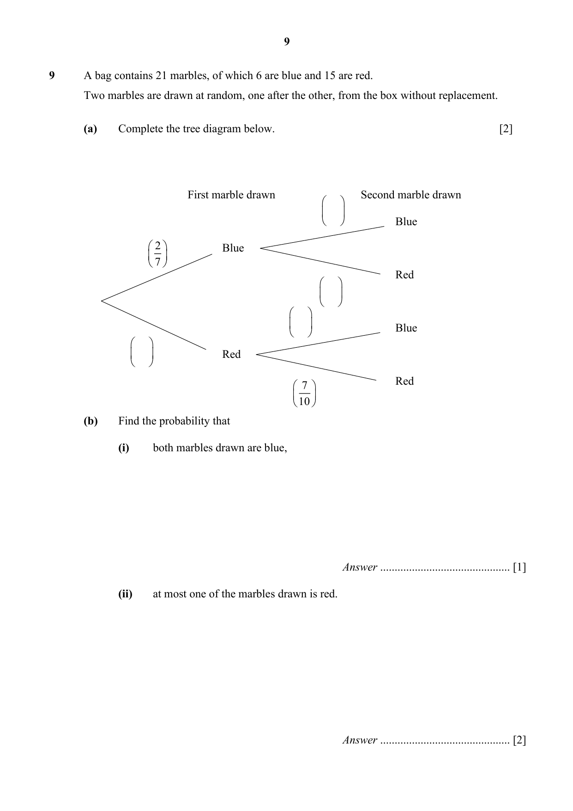

## Question

> **Marks:** (a) 2, (b)(i) 1, (b)(ii) 2; total 5
> **Page:** 9

A bag contains 21 marbles, of which 6 are blue and 15 are red.
Two marbles are drawn at random, one after the other, from the box without replacement.

**(a)** Complete the tree diagram below. [2]

**(b)** Find the probability that

**(i)** both marbles drawn are blue, [1]

**(ii)** at most one of the marbles drawn is red. [2]

## Answer Scheme

A bag contains 21 marbles, of which 6 are blue and 15 are red. Two marbles are drawn at random, one after the other, from the box without replacement.

**(a)** Complete the tree diagram below. [2]

First marble blue $\dfrac{2}{7}$, then second blue $\dfrac{5}{20}=\dfrac{1}{4}$, second red $\dfrac{15}{20}=\dfrac{3}{4}$.

First marble red $\dfrac{15}{21}=\dfrac{5}{7}$, then second blue $\dfrac{6}{20}=\dfrac{3}{10}$, second red $\dfrac{7}{10}$.

> **Markers Report:** In general, well done. Students forget to reduce fractions.

**(b)** Find the probability that

**(i)** both marbles drawn are blue.

$$\frac{2}{7}\times\frac{1}{4}=\frac{1}{14}$$

**(ii)** at most one of the marbles drawn is red.

$$1-\left(\frac{5}{7}\times\frac{7}{10}\right)=\frac{1}{2}$$

or

$$\left(\frac{5}{7}\times\frac{3}{10}\right)+\left(\frac{2}{7}\times\frac{3}{4}\right)+\left(\frac{2}{7}\times\frac{1}{4}\right)=\frac{1}{2}$$

> **Markers Report:** (b)(i) In general, well done. (b)(ii) Students did not interpret correctly and included the case where both are red.
