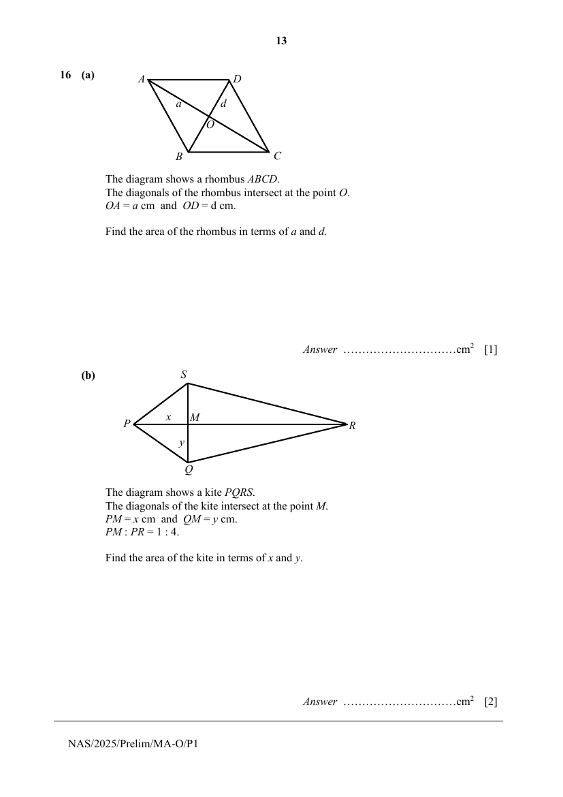

## Question

> **Marks:** (a) 1, (b) 2; total 3
> **Page:** 13

**(a)** The diagram shows a rhombus $ABCD$.
The diagonals of the rhombus intersect at the point $O$.
$OA = a$ cm and $OD = d$ cm.

Find the area of the rhombus in terms of $a$ and $d$. [1]

**(b)** The diagram shows a kite $PQRS$.
The diagonals of the kite intersect at the point $M$.
$PM = x$ cm and $QM = y$ cm.
$PM:PR = 1:4$.

Find the area of the kite in terms of $x$ and $y$. [2]

## Answer Scheme

**(a)** $AC=2a$

$BD=2d$

Area of rhombus

$$
=\frac{1}{2}(2a\times 2d)=2ad
$$

**(b)** Area of triangle $PQS$

$$
=\frac{1}{2}(x\times 2y)=xy
$$

$MR=3x$

Area of triangle $RQS$

$$
=\frac{1}{2}(3x\times 2y)=3xy
$$

Area of kite

$$
=xy+3xy=4xy
$$
