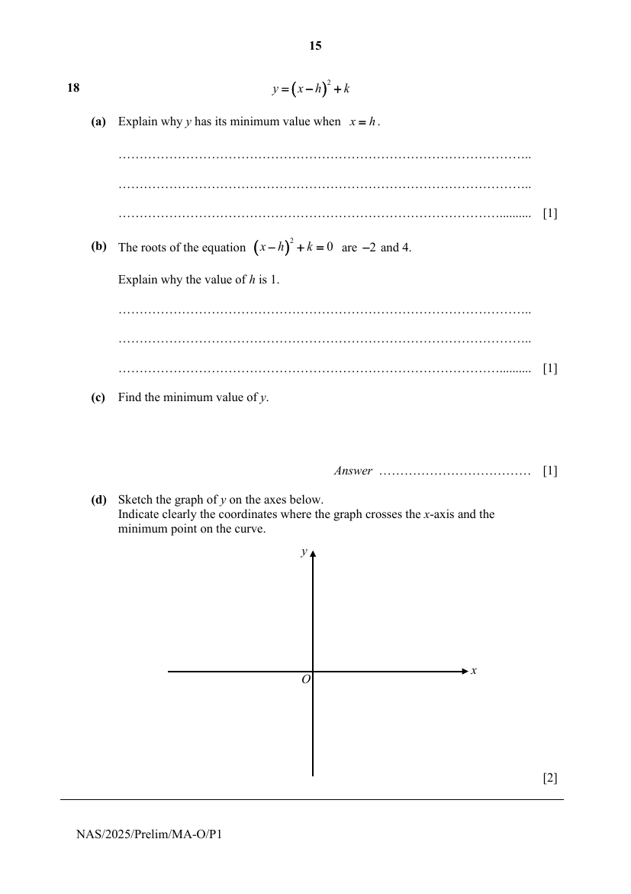
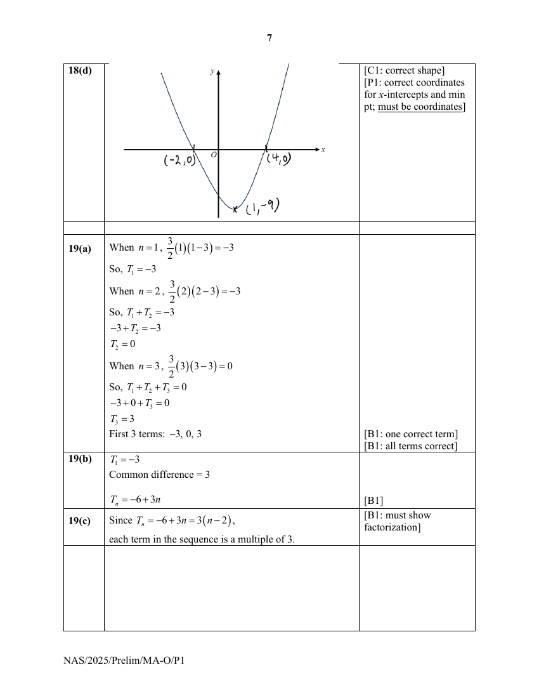

## Question

> **Marks:** (a) 1, (b) 1, (c) 1, (d) 2; total 5
> **Page:** 15

$$
y=(x-h)^{2}+k
$$

**(a)** Explain why $y$ has its minimum value when $x=h$. [1]

**(b)** The roots of the equation $(x-h)^{2}+k=0$ are $-2$ and $4$.

Explain why the value of $h$ is $1$. [1]

**(c)** Find the minimum value of $y$. [1]

**(d)** Sketch the graph of $y$ on the axes below.
Indicate clearly the coordinates where the graph crosses the $x$-axis and the minimum point on the curve. [2]

## Answer Scheme

**(a)** When $x\neq h$, $(x-h)^{2}>0$ and $y=(x-h)^{2}+k>k$.

When $x=h$, $(x-h)^{2}=0$ and $y=(x-h)^{2}+k=k$. (Or mention that coeff of $x^{2}$ is positive)

So, $y$ has its minimum value of $k$ when $x=h$.

**(b)** Since the graph of $y=(x-h)^{2}+k$ is symmetrical about the vertical line passing through its minimum point,

$$
h=\frac{-2+4}{2}
$$

$$
h=1\text{ (shown)}
$$

**(c)** Sub $x=4$, $y=0$, $h=1$,

$$
0=(4-1)^{2}+k
$$

$$
k=-9
$$

Min. value of $y$ is $-9$.

**(d)**

