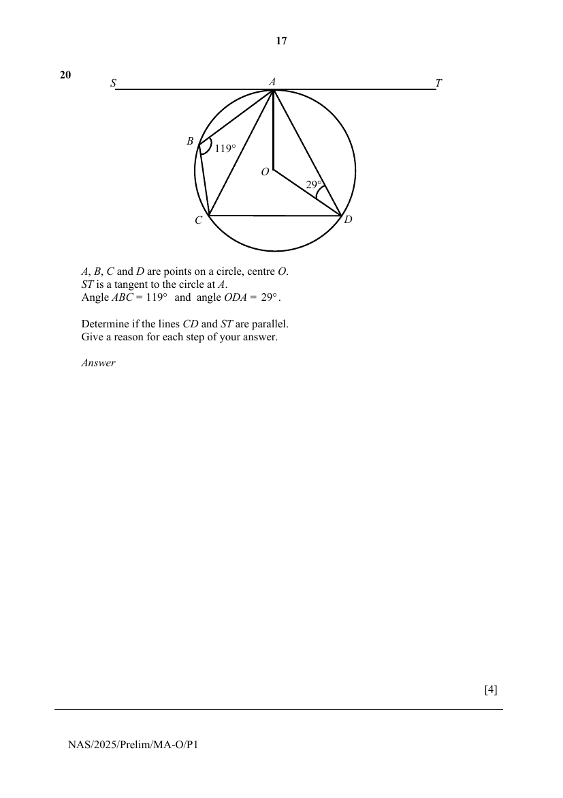

## Question

> **Marks:** 4
> **Page:** 17

$A$, $B$, $C$ and $D$ are points on a circle, centre $O$.
$ST$ is a tangent to the circle at $A$.
Angle $ABC = 119^{\circ}$ and angle $ODA = 29^{\circ}$.

Determine if the lines $CD$ and $ST$ are parallel.
Give a reason for each step of your answer. [4]

## Answer Scheme

$$
\angle CDA=180^{\circ}-119^{\circ}\text{ ($\angle$s in opp. segments)}
$$

$$
=61^{\circ}
$$

$$
\angle OAT=90^{\circ}\text{ (tan $\perp$ rad)}
$$

$$
\angle OAD=29^{\circ}\text{ (base $\angle$s of isos. $\triangle$)}
$$

So, $\angle DAT=90^{\circ}-29^{\circ}$

$$
=61^{\circ}
$$

Since $\angle CDA=\angle DAT$, they are alternate angles and lines $CD$ and $ST$ are parallel.
