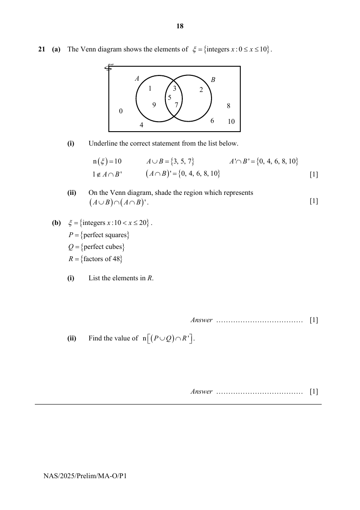
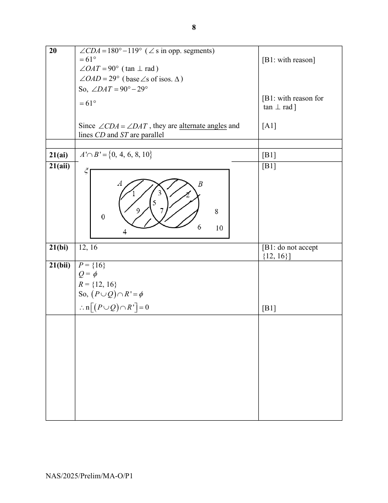

## Question

> **Marks:** (a)(i) 1, (a)(ii) 1, (b)(i) 1, (b)(ii) 1; total 4
> **Page:** 18

**(a)** The Venn diagram shows the elements of $\xi=\{\text{integers }x:0\leq x\leq 10\}$.

**(i)** Underline the correct statement from the list below.

$\mathrm{n}(\xi)=10$

$A\cup B=\{3, 5, 7\}$

$A'\cap B'=\{0, 4, 6, 8, 10\}$

$1\notin A\cap B'$

$(A\cap B)'=\{0, 4, 6, 8, 10\}$ [1]

**(ii)** On the Venn diagram, shade the region which represents $(A\cup B)\cap(A\cap B)'$. [1]

**(b)** $\xi=\{\text{integers }x:10<x\leq 20\}$.

$P=\{\text{perfect squares}\}$

$Q=\{\text{perfect cubes}\}$

$R=\{\text{factors of }48\}$

**(i)** List the elements in $R$. [1]

**(ii)** Find the value of $\mathrm{n}\left[(P\cup Q)\cap R'\right]$. [1]

## Answer Scheme

**(a)(i)** $A'\cap B'=\{0, 4, 6, 8, 10\}$

**(a)(ii)**

**(b)(i)** $12$, $16$

**(b)(ii)** $P=\{16\}$

$Q=\phi$

$R=\{12, 16\}$

So, $(P\cup Q)\cap R'=\phi$

$$
\therefore \mathrm{n}\left[(P\cup Q)\cap R'\right]=0
$$
