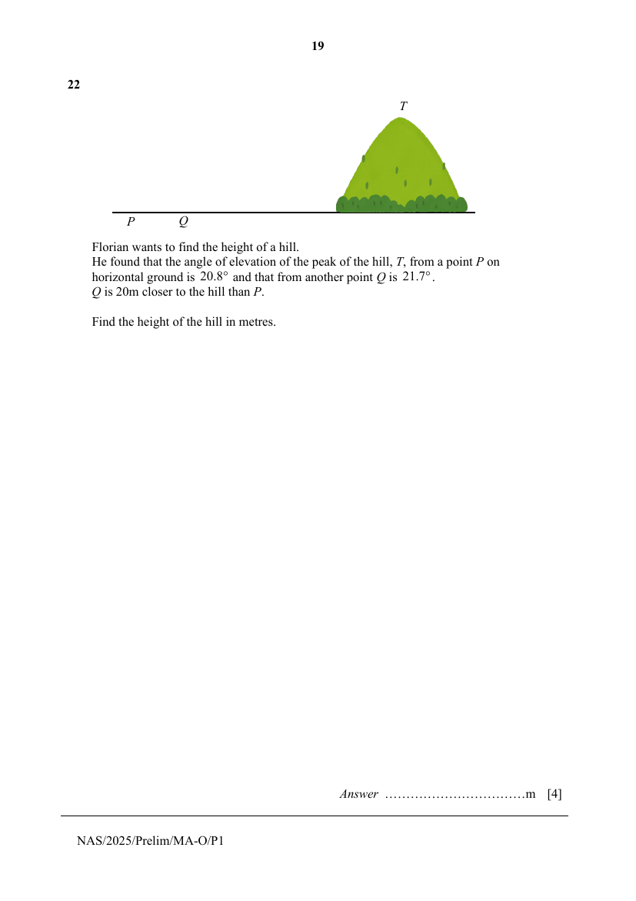
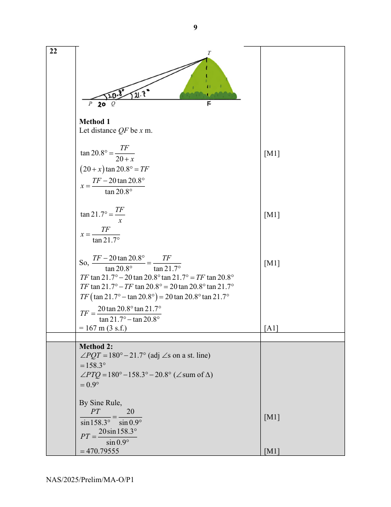

## Question

> **Marks:** 4
> **Page:** 19

Florian wants to find the height of a hill.
He found that the angle of elevation of the peak of the hill, $T$, from a point $P$ on horizontal ground is $20.8^{\circ}$ and that from another point $Q$ is $21.7^{\circ}$.
$Q$ is 20 m closer to the hill than $P$.

Find the height of the hill in metres. [4]

## Answer Scheme

**Method 1**

Let distance $QF$ be $x$ m.

$$
\tan 20.8^{\circ}=\frac{TF}{20+x}
$$

$$
(20+x)\tan 20.8^{\circ}=TF
$$

$$
x=\frac{TF-20\tan 20.8^{\circ}}{\tan 20.8^{\circ}}
$$

$$
\tan 21.7^{\circ}=\frac{TF}{x}
$$

$$
x=\frac{TF}{\tan 21.7^{\circ}}
$$

So,

$$
\frac{TF-20\tan 20.8^{\circ}}{\tan 20.8^{\circ}}=\frac{TF}{\tan 21.7^{\circ}}
$$

$$
TF\tan 21.7^{\circ}-20\tan 20.8^{\circ}\tan 21.7^{\circ}=TF\tan 20.8^{\circ}
$$

$$
TF\tan 21.7^{\circ}-TF\tan 20.8^{\circ}=20\tan 20.8^{\circ}\tan 21.7^{\circ}
$$

$$
TF(\tan 21.7^{\circ}-\tan 20.8^{\circ})=20\tan 20.8^{\circ}\tan 21.7^{\circ}
$$

$$
TF=\frac{20\tan 20.8^{\circ}\tan 21.7^{\circ}}{\tan 21.7^{\circ}-\tan 20.8^{\circ}}
$$

$$
=167\text{ m (3 s.f.)}
$$

**Method 2**

$$
\angle PQT=180^{\circ}-21.7^{\circ}\text{ (adj $\angle$s on a st. line)}
$$

$$
=158.3^{\circ}
$$

$$
\angle PTQ=180^{\circ}-158.3^{\circ}-20.8^{\circ}\text{ ($\angle$ sum of $\triangle$)}
$$

$$
=0.9^{\circ}
$$

By Sine Rule,

$$
\frac{PT}{\sin 158.3^{\circ}}=\frac{20}{\sin 0.9^{\circ}}
$$

$$
PT=\frac{20\sin 158.3^{\circ}}{\sin 0.9^{\circ}}
$$

$$
=470.79555
$$

$$
\sin 20.8^{\circ}=\frac{TF}{470.79555}
$$

$$
TF=470.79555\sin 20.8^{\circ}
$$

$$
=167\text{ m (3 s.f.)}
$$
