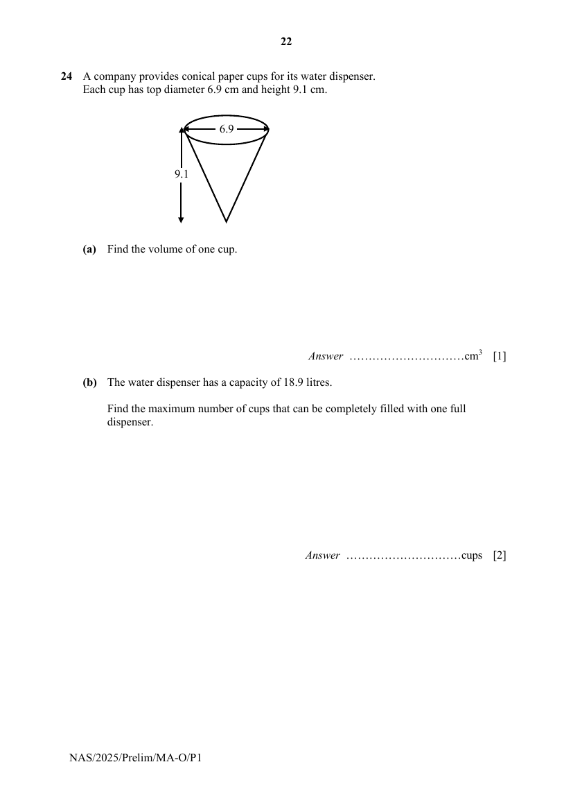
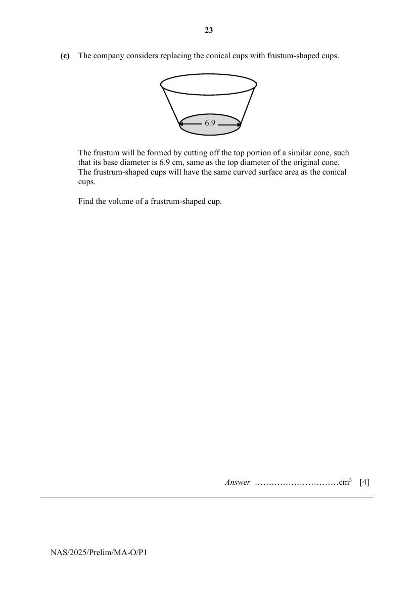

## Question

> **Marks:** (a) 1, (b) 2, (c) 4; total 7
> **Page:** 22–23

A company provides conical paper cups for its water dispenser.
Each cup has top diameter 6.9 cm and height 9.1 cm.

**(a)** Find the volume of one cup. [1]

**(b)** The water dispenser has a capacity of 18.9 litres.

Find the maximum number of cups that can be completely filled with one full dispenser. [2]

**(c)** The company considers replacing the conical cups with frustum-shaped cups.

The frustum will be formed by cutting off the top portion of a similar cone, such that its base diameter is 6.9 cm, same as the top diameter of the original cone.
The frustum-shaped cups will have the same curved surface area as the conical cups.

Find the volume of a frustum-shaped cup. [4]

## Answer Scheme

**(a)** Volume of one cup

$$
=\frac{1}{3}\pi\left(\frac{6.9}{2}\right)^{2}(9.1)
$$

$$
=113.4248
$$

$$
=113\text{ cm}^{3}\text{ (3 s.f.)}
$$

**(b)** $18.9\text{ l}=18\,900\text{ cm}^{3}$

Max number of cups

$$
=\frac{18900}{113.4248}
$$

$$
=166.63
$$

$=166$ cups that are completely filled

**(c)** Let the curved surface area of smaller cone (i.e. cup) be $A_{1}$, $t$ and that of larger cone (i.e. cup + frustrum) be $A_{2}$.

By similar cones,

$$
\left(\frac{d_{2}}{d_{1}}\right)^{2}=\frac{A_{2}}{A_{1}}=2
$$

$$
\frac{d_{2}}{d_{1}}=\sqrt{2}
$$

$$
\frac{V_{2}}{V_{1}}=\left(\frac{d_{2}}{d_{1}}\right)^{3}
$$

$$
=(\sqrt{2})^{3}
$$

$$
V_{2}=(\sqrt{2})^{3}\times 113.4248
$$

$$
=320.81378
$$

Volume of frustrum shaped cup

$$
=320.81378-113.4248
$$

$$
=207\text{ cm}^{3}\text{ (3 s.f.)}
$$
