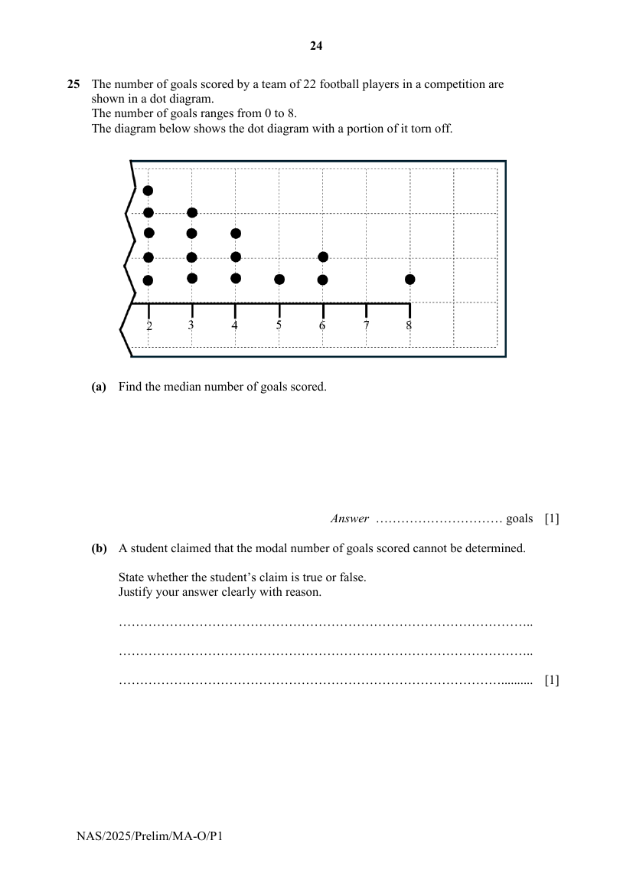

## Question

> **Marks:** (a) 1, (b) 1, (c)(i) 1, (c)(ii) 1, (c)(iii) 1; total 5
> **Page:** 24–25

The number of goals scored by a team of 22 football players in a competition are shown in a dot diagram.
The number of goals ranges from 0 to 8.
The diagram below shows the dot diagram with a portion of it torn off.

**(a)** Find the median number of goals scored. [1]

**(b)** A student claimed that the modal number of goals scored cannot be determined.

State whether the student’s claim is true or false.
Justify your answer clearly with reason. [1]

**(c)** A player is randomly selected from the 22 players.

**(i)** Find the probability that the student scored 7 goals. [1]

**(ii)** Find the probability that the player scored at least 5 goals. [1]

**(iii)** Find the probability that the player scored at most 2 goals. [1]

## Answer Scheme

**(a)** Position of median

$$
=\frac{22+1}{2}=11.5
$$

$$
\text{Median}=\frac{2+3}{2}=2.5
$$

**(b)** The student’s claim is true because there are 6 missing data in the dot diagram. If all the 6 students scored 0 goal (or 1 goal), the modal number of goals scored would be 0 (or 1) instead of 2.

**(c)(i)** $0$

**(c)(ii)** $\dfrac{4}{22}=\dfrac{2}{11}$

**(c)(iii)** $\dfrac{11}{22}=\dfrac{1}{2}$
