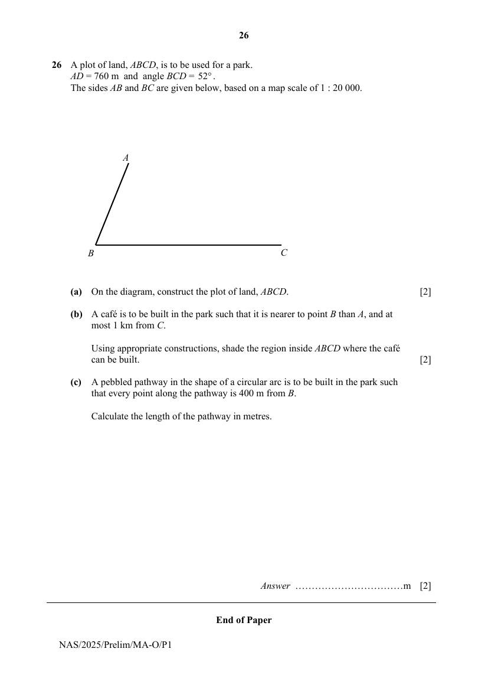

## Question

> **Marks:** (a) 2, (b) 2, (c) 2; total 6
> **Page:** 26

A plot of land, $ABCD$, is to be used for a park.
$AD = 760$ m and angle $BCD = 52^{\circ}$.
The sides $AB$ and $BC$ are given below, based on a map scale of $1:20\,000$.

**(a)** On the diagram, construct the plot of land, $ABCD$. [2]

**(b)** A café is to be built in the park such that it is nearer to point $B$ than $A$, and at most 1 km from $C$.

Using appropriate constructions, shade the region inside $ABCD$ where the café can be built. [2]

**(c)** A pebbled pathway in the shape of a circular arc is to be built in the park such that every point along the pathway is 400 m from $B$.

Calculate the length of the pathway in metres. [2]

---

End of Paper

## Answer Scheme

**(a)** $1\text{ cm}:20\,000\text{ cm}$

$1\text{ cm}:200\text{ m}$

$3.8\text{ cm}:760\text{ m}$

**(b)** Refer to diagram above.

**(c)** $\angle ABC=68^{\circ}$

Length of pathway

$$
=\frac{68}{360}\times 2\pi(400)
$$

$$
=475\text{ m (3 s.f.)}
$$
