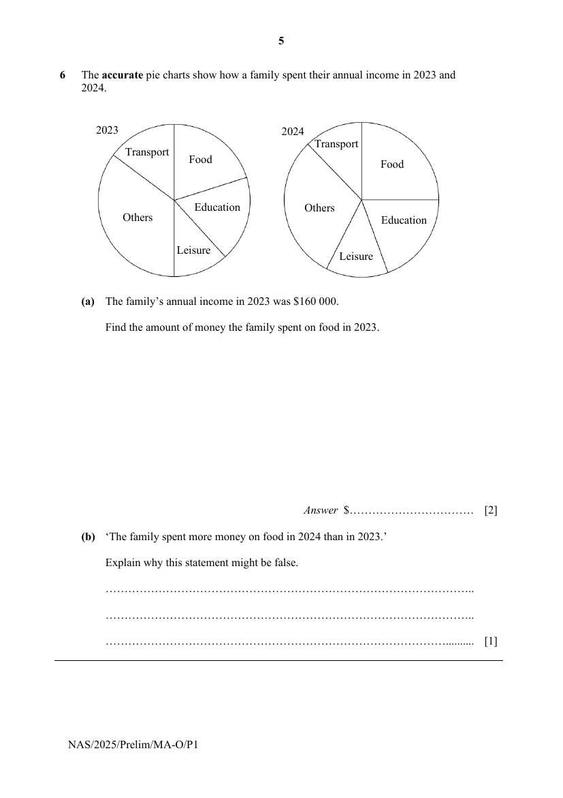

## Question

> **Marks:** (a) 2, (b) 1; total 3
> **Page:** 5

The accurate pie charts show how a family spent their annual income in 2023 and 2024.

**(a)** The family’s annual income in 2023 was &#36;160 000.

Find the amount of money the family spent on food in 2023. [2]

**(b)** ‘The family spent more money on food in 2024 than in 2023.’

Explain why this statement might be false. [1]

## Answer Scheme

**(a)**

$$
\frac{72}{360}\times 160000=&#36;32000
$$

**(b)** The family’s annual income in 2024 might be less than that in 2023, such that even though they spent a great proportion of their income on food in 2024 ($25\%$ compared to $\dfrac{72}{360}\times 100\%=20\%$), the total amount spent on food in 2024 might be less than that in 2023.
