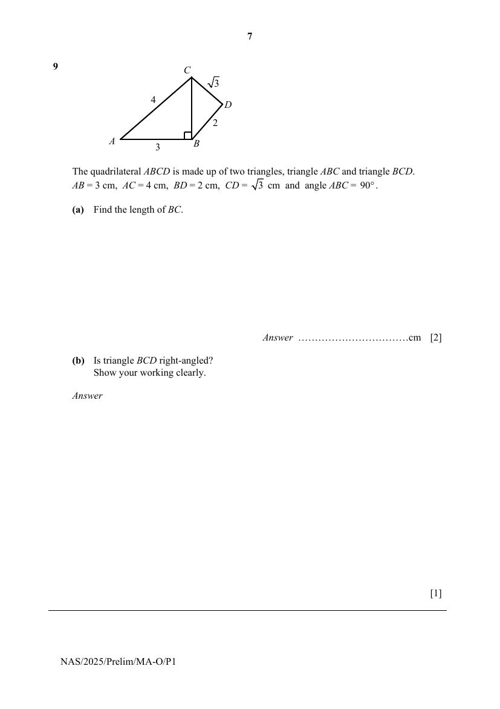

## Question

> **Marks:** (a) 2, (b) 1; total 3
> **Page:** 7

The quadrilateral $ABCD$ is made up of two triangles, triangle $ABC$ and triangle $BCD$.
$AB = 3$ cm, $AC = 4$ cm, $BD = 2$ cm, $CD = \sqrt{3}$ cm and angle $ABC = 90^{\circ}$.

**(a)** Find the length of $BC$. [2]

**(b)** Is triangle $BCD$ right-angled?
Show your working clearly. [1]

## Answer Scheme

**(a)**

$$
BC=\sqrt{4^{2}-3^{2}}
$$

$$
=\sqrt{7}
$$

$$
=2.65\text{ cm (3 s.f.)}
$$

**(b)**

$$
BC^{2}=(\sqrt{7})^{2}=7
$$

$$
BD^{2}+CD^{2}=(2)^{2}+(\sqrt{3})^{2}=7
$$

Since $BC^{2}=BD^{2}+CD^{2}$, by the Converse of Pythagoras’ Theorem, triangle $BCD$ is right-angled.
