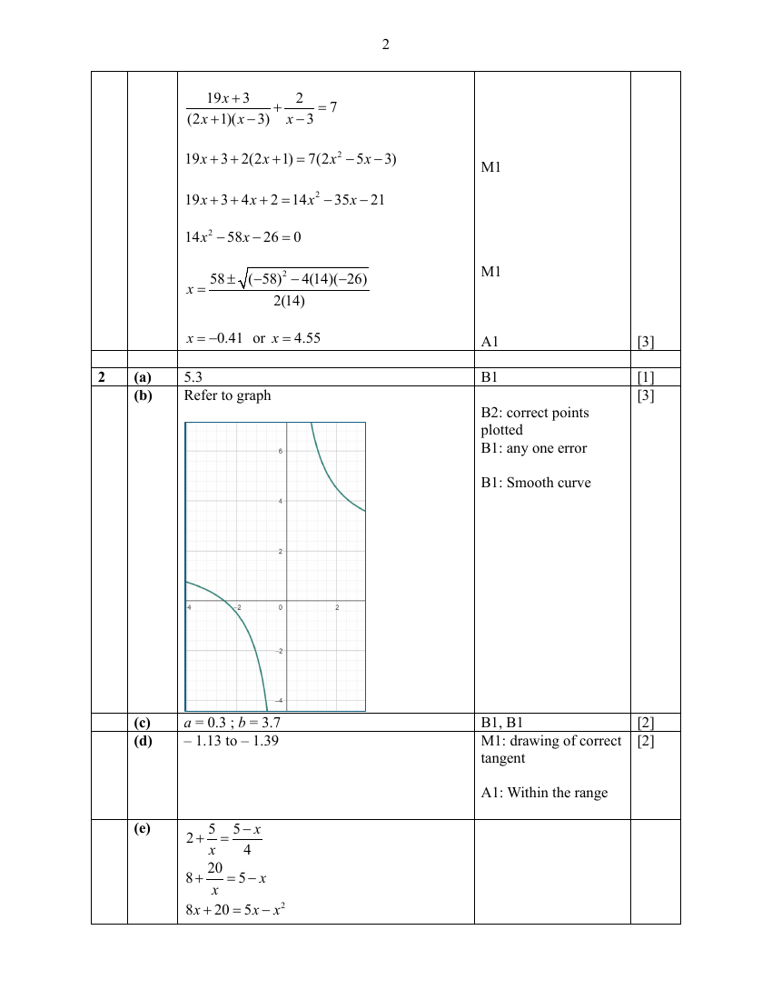

## Question

> **Marks:** (a) 1, (b) 3, (c) 2, (d) 2, (e) 2; total 10
> **Page:** 6–8

**(a)** Complete the table of values for $y=2+\dfrac{5}{x}$. [1]

| $x$ | $-3$ | $-2$ | $-1$ | $1$ | $1.5$ | $2$ | $3$ |
|---|---|---|---|---|---|---|---|
| $y$ | $0.3$ | $-0.5$ | $-3$ | $7$ |  | $4.5$ | $3.7$ |

**(b)** On the grid opposite, draw the graph of $y=2+\dfrac{5}{x}$ for $-3\leq x\leq 3$. [3]

**(c)** The equation $2+\dfrac{5}{x}=t$ has no solution for $-3\leq x\leq 3$.
Given that $a<t<b$, use your graph to find the possible values of $a$ and $b$. [2]

**(d)** By drawing a tangent, find the gradient of the curve at $x=2$. [2]

**(e)** The points of intersection of the line $4y=5-x$ and the curve give the solutions of the equation $Ax^{2}-Bx+20=0$.

Find the value of $A$ and $B$. [2]

## Answer Scheme

**(a)** $5.3$

**(b)** Refer to graph.

**(c)** $a=0.3$; $b=3.7$

**(d)** $-1.13$ to $-1.39$

**(e)**

$$
2+\frac{5}{x}=\frac{5-x}{4}
$$

$$
8+\frac{20}{x}=5-x
$$

$$
8x+20=5x-x^{2}
$$

$$
x^{2}+3x+20=0
$$

$A=1$ and $B=-3$
