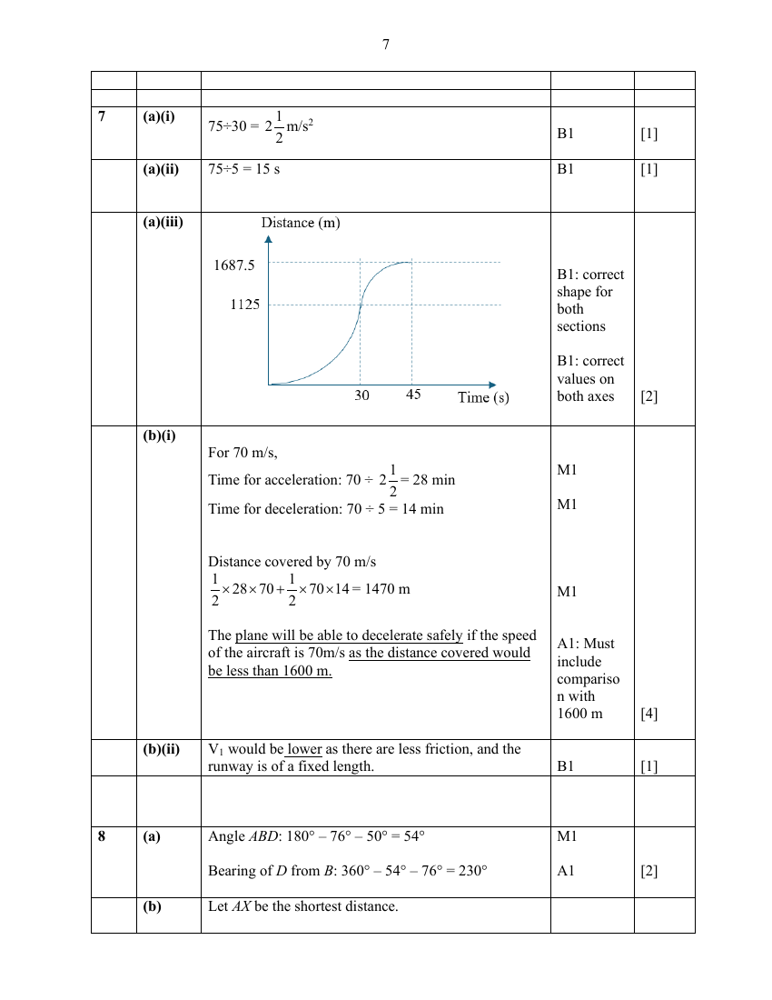

## Question

> **Marks:** (a)(i) 1, (a)(ii) 1, (a)(iii) 2, (b)(i) 4, (b)(ii) 1; total 9
> **Page:** 18–20

During take-off, an aircraft accelerates from standstill to the take-off speed before becoming airborne.

An aircraft can accelerate constantly from standstill on a runway until it reaches a take-off speed of 75 m/s in 30 seconds.

In the event of an emergency, the aircraft can decelerate constantly at 5 m/s$^{2}$ on a runway until it comes to a rest.

The speed-time graph below illustrates the journey of the aircraft from standstill to take-off speed and then deceleration till rest.

**(a)(i)** Calculate the acceleration of the aircraft for the first 30 seconds. [1]

**(ii)** Find the time taken for the aircraft to decelerate from the take-off speed until it comes to a rest. [1]

**(iii)** Sketch the distance-time graph of the entire aircraft journey until it comes to a rest, indicating clearly the distance travelled. [2]

**(b)** For safety reasons, the pilot needs to determine the take-off decision speed ($V_{1}$) before a take-off.

$V_{1}$ is the maximum speed which the aircraft can reach before it starts decelerating in case of an emergency.
It will not be safe for the aircraft to decelerate after $V_{1}$ as the runway will not be long enough.

**(i)** If the speed of an aircraft is 70 m/s, determine if the aircraft can decelerate safely in case of an emergency for a runway length of 1600 m.
Assume that the acceleration and deceleration of the aircraft are the same as the values found or given in (a). [4]

**(ii)** If the runway is wet, explain what will happen to $V_{1}$. [1]

## Answer Scheme

**(a)(i)**

$$
75\div 30=2\frac{1}{2}\text{ m/s}^{2}
$$

**(a)(ii)** $75\div 5=15$ s

**(a)(iii)**

**(b)(i)** For 70 m/s,

Time for acceleration: $70\div 2\dfrac{1}{2}=28$ min

Time for deceleration: $70\div 5=14$ min

Distance covered by 70 m/s

$$
\frac{1}{2}\times 28\times 70+\frac{1}{2}\times 70\times 14=1470\text{ m}
$$

The plane will be able to decelerate safely if the speed of the aircraft is 70 m/s as the distance covered would be less than 1600 m.

**(b)(ii)** $V_{1}$ would be lower as there are less friction, and the runway is of a fixed length.
