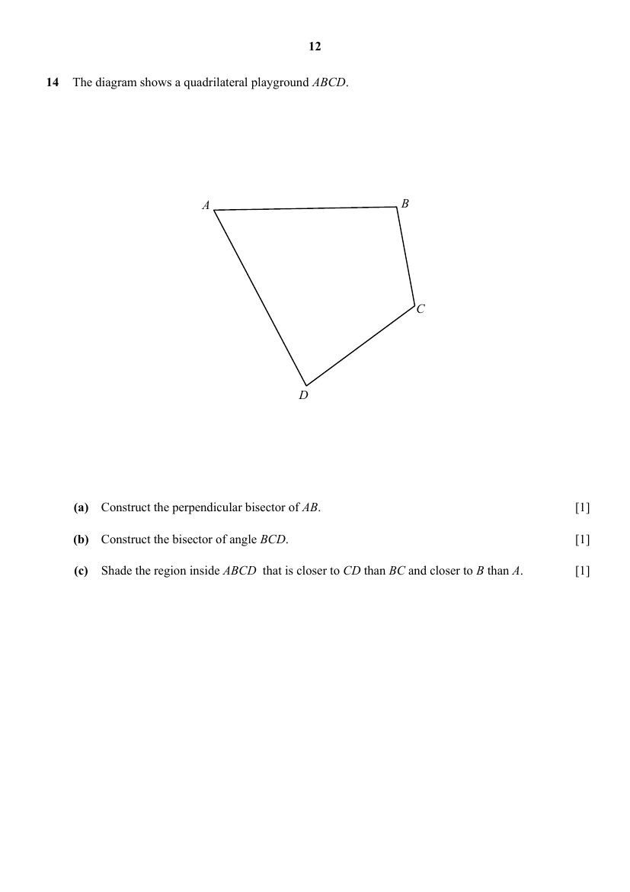

## Question

> **Marks:** (a) 1, (b) 1, (c) 1; total 3
> **Page:** 12

The diagram shows a quadrilateral playground $ABCD$.

**(a)** Construct the perpendicular bisector of $AB$. [1]

**(b)** Construct the bisector of angle $BCD$. [1]

**(c)** Shade the region inside $ABCD$ that is closer to $CD$ than $BC$ and closer to $B$ than $A$. [1]

## Answer Scheme

Construction is on the solutions page. Perpendicular bisector of $AB$, angle bisector of $\angle BCD$, and the region closer to $CD$ than to $BC$ and closer to $B$ than to $A$.

