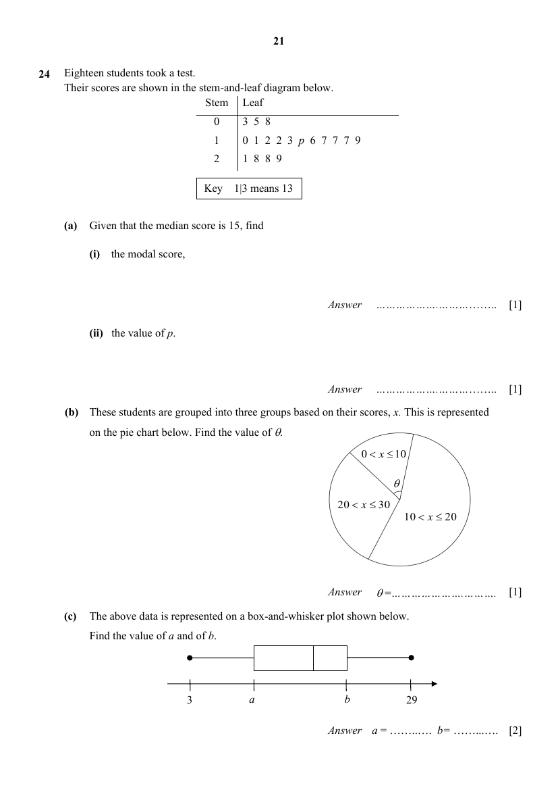

## Question

> **Marks:** (a)(i) 1, (a)(ii) 1, (b) 1, (c) 2; total 5
> **Page:** 21

Eighteen students took a test. Their scores are shown in the stem-and-leaf diagram below.

| Stem | Leaf |
| --- | --- |
| 0 | 3 5 8 |
| 1 | 0 1 2 2 3 $p$ 6 7 7 7 9 |
| 2 | 1 8 8 9 |

Key: $1\mid 3$ means $13$.

**(a)** Given that the median score is $15$, find

**(i)** the modal score, [1]

**(ii)** the value of $p$. [1]

**(b)** These students are grouped into three groups based on their scores, $x$. This is represented on the pie chart below. Find the value of $\theta$. [1]

**(c)** The above data is represented on a box-and-whisker plot shown below. Find the value of $a$ and of $b$. [2]

## Answer Scheme

**(a)** **(i)** $17$

**(ii)** $p=4$

**(b)** $\theta=80^{\circ}$

**(c)** $a=11$, $b=19$
