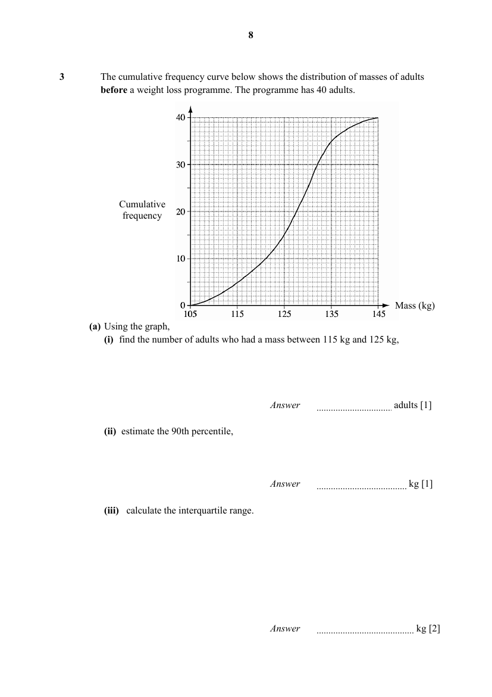

## Question

> **Marks:** (a)(i) 1, (a)(ii) 1, (a)(iii) 2, (b)(i) 2, (b)(ii) 2, (c) 1; total 9
> **Page:** 8–9

The cumulative frequency curve below shows the distribution of masses of adults before a weight loss programme. The programme has $40$ adults.

**(a)** Using the graph,

**(i)** find the number of adults who had a mass between $115\text{ kg}$ and $125\text{ kg}$, [1]

**(ii)** estimate the 90th percentile, [1]

**(iii)** calculate the interquartile range. [2]

**(b)** Two adults were selected at random before the programme. Find the probability that

**(i)** at least one of the two adults was heavier than $135\text{ kg}$, [2]

**(ii)** one of the two adults was heavier than $120\text{ kg}$ and the other was not. [2]

**(c)** The weight of these $40$ adults are taken again after the weight loss programme. The details are shown below:

| Median | 25th percentile | 75th percentile |
| --- | --- | --- |
| $115\text{ kg}$ | $110\text{ kg}$ | $119\text{ kg}$ |

Make a comparison between the before and after programme to determine if the programme is effective. [1]

## Answer Scheme

**(a)** **(i)** $10$ adults

**(ii)** $136\text{ kg}$

**(iii)** $132-121=11\text{ kg}$

**(b)** **(i)** $\dfrac{37}{156}$

**(ii)** $\dfrac{93}{260}$

**(c)** The median is $127.5\text{ kg}$ before the programme and $115\text{ kg}$ after the programme. This shows the adults participating in the event is lighter after the programme. In conclusion, the programme is effective.
