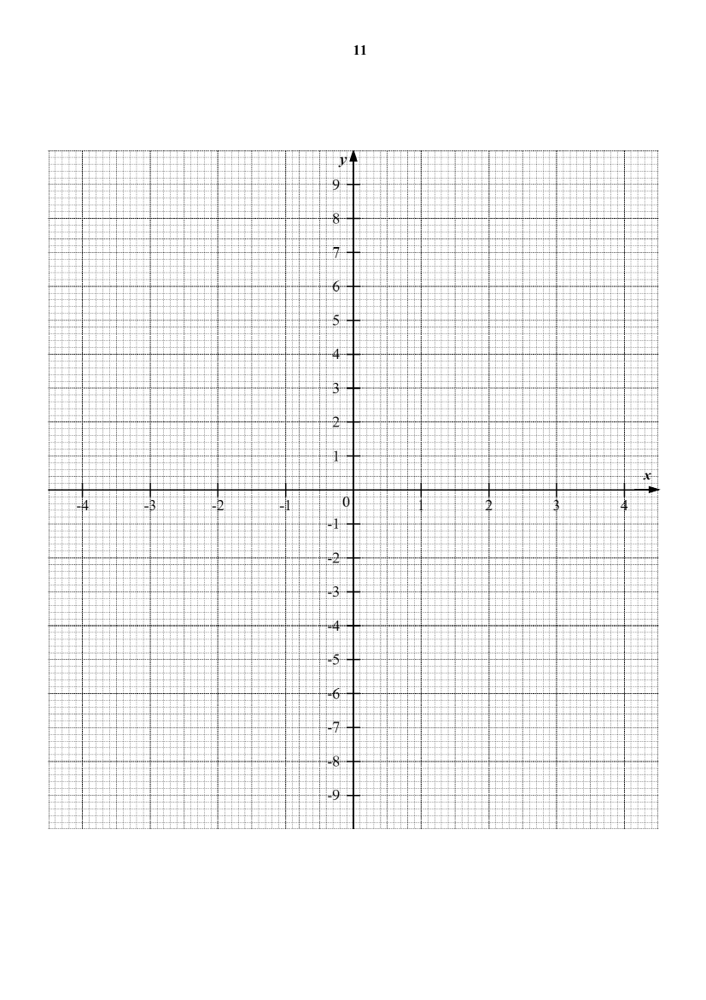

## Question

> **Marks:** (a) 1, (b) 3, (c) 1, (d) 2, (e) 3; total 10
> **Page:** 10–11

**(a)** Complete the table of values for $y=\dfrac{3x^{3}}{10}-x+1$. [1]

| $x$ | $-3$ | $-2$ | $-1$ | $0$ | $1$ | $2$ | $3$ |
| --- | --- | --- | --- | --- | --- | --- | --- |
| $y$ | $p$ | $0.6$ | $1.7$ | $1$ | $0.3$ | $1.4$ | $6.1$ |

**(b)** On the grid opposite, draw the graph of $y=\dfrac{3x^{3}}{10}-x+1$ for $-3\leq x\leq 3$. [3]

**(c)** The equation $k=\dfrac{3x^{3}}{10}-x+1$ has $2$ solutions in the range $-3\leq x\leq 3$. Write down the value(s) of $k$. [1]

**(d)** By drawing a tangent, find the gradient of the curve at $x=1.6$. [2]

**(e)** By drawing a suitable straight line on the grid, solve the equation $3x^{3}-30x-20=0$. [3]

## Answer Scheme

**(a)** $p=-4.1$

**(b)** Graph of $y=\dfrac{3x^{3}}{10}-x+1$ for $-3\leq x\leq 3$.

**(c)** $k=1.70$, $k=0.30$

**(d)** $1.33$

**(e)** The straight line used is $y=2x+3$, from $\dfrac{3x^{3}}{10}-x+1=2x+3$. $x=-2.7$, $-0.7$.
