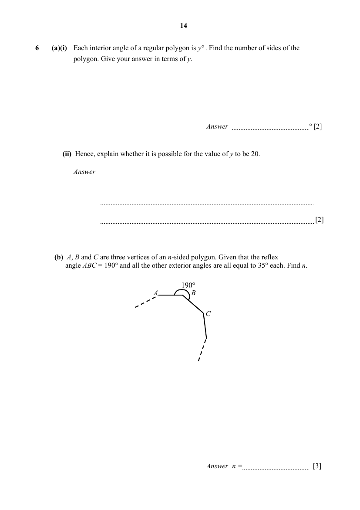

## Question

> **Marks:** (a)(i) 2, (a)(ii) 2, (b) 3; total 7
> **Page:** 14

**(a)** **(i)** Each interior angle of a regular polygon is $y^{\circ}$. Find the number of sides of the polygon. Give your answer in terms of $y$. [2]

**(ii)** Hence, explain whether it is possible for the value of $y$ to be $20$. [2]

**(b)** $A$, $B$ and $C$ are three vertices of an $n$-sided polygon. Given that the reflex angle $ABC=190^{\circ}$ and all the other exterior angles are all equal to $35^{\circ}$ each. Find $n$. [3]

## Answer Scheme

**(a)** **(i)** $n=\dfrac{360}{180-y}$

**(ii)** When $y=20$, $n=\dfrac{9}{4}$. Since $n$ is not an integer, it is not possible.

**(b)** Exterior angle at $B$ is $10^{\circ}$. $(n-1)35^{\circ}+10^{\circ}=360^{\circ}$, so $n=11$.
