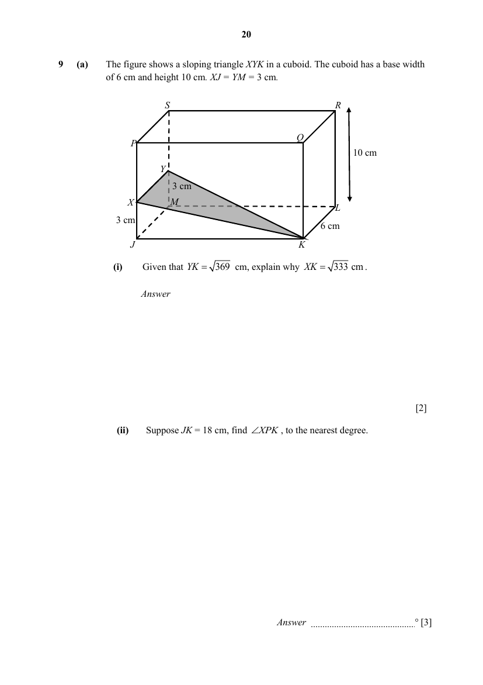
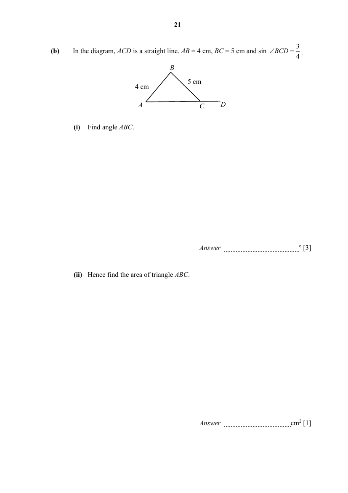

## Question

> **Marks:** (a)(i) 2, (a)(ii) 3, (b)(i) 3, (b)(ii) 1; total 9
> **Page:** 20–21

**(a)** The figure shows a sloping triangle $XYK$ in a cuboid. The cuboid has a base width of $6\text{ cm}$ and height $10\text{ cm}$. $XJ=YM=3\text{ cm}$.

**(i)** Given that $YK=\sqrt{369}\text{ cm}$, explain why $XK=\sqrt{333}\text{ cm}$. [2]

**(ii)** Suppose $JK=18\text{ cm}$, find $\angle XPK$, to the nearest degree. [3]

**(b)** In the diagram, $ACD$ is a straight line. $AB=4\text{ cm}$, $BC=5\text{ cm}$ and $\sin\angle BCD=\dfrac{3}{4}$.

**(i)** Find angle $ABC$. [3]

**(ii)** Hence find the area of triangle $ABC$. [1]

## Answer Scheme

**(a)** **(i)** $369-6^{2}=XK^{2}$, so $XK^{2}=333$ and $XK=\sqrt{333}$ (shown).

**(ii)** The answer key gives $60.9^{\circ}$. One method in the solutions copy uses $\tan^{-1}\left(\dfrac{18}{10}\right)$ and another uses the cosine rule, and that copy then rounds to $61^{\circ}$.

**(b)** **(i)** $61.8^{\circ}$

**(ii)** $8.81\text{ cm}^{2}$
