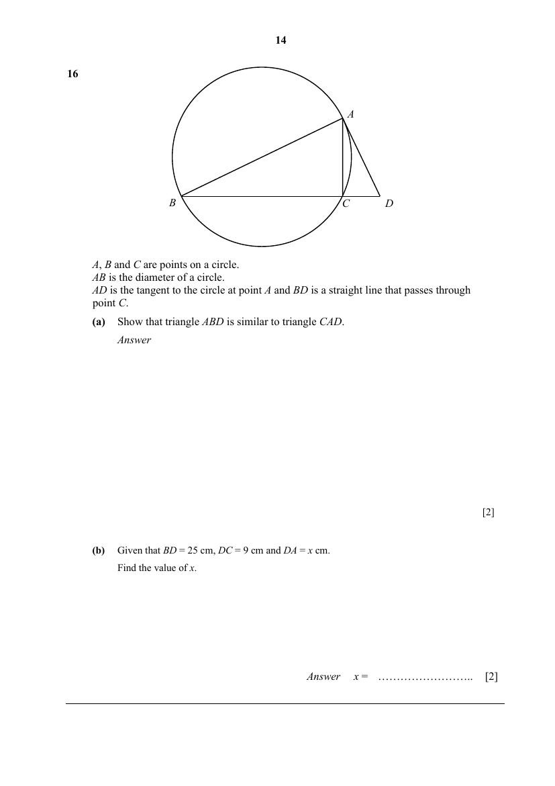

## Question

> **Marks:** (a) 2, (b) 2; total 4
> **Page:** 14

$A$, $B$ and $C$ are points on a circle.
$AB$ is the diameter of a circle.
$AD$ is the tangent to the circle at point $A$ and $BD$ is a straight line that passes through point $C$.

**(a)** Show that triangle $ABD$ is similar to triangle $CAD$. [2]

**(b)** Given that $BD = 25$ cm, $DC = 9$ cm and $DA = x$ cm.
Find the value of $x$. [2]

## Answer Scheme

**(a)**

$$
\angle BAD=90^{\circ}\text{ (tangent perpendicular to radius)}
$$

$$
\angle ACB=90^{\circ}\text{ (angle in a semicircle)}
$$

$$
\angle ACD=90^{\circ}\text{ (adjacent angles on a straight line)}
$$

$$
\angle BAD=\angle ACD=90^{\circ}
$$

$$
\angle BDA=\angle ADC\text{ (common angle)}
$$

$\triangle CDA$ and $\triangle ADB$ are similar (AA Similarity Test)

**(b)**

$$
\frac{x}{9}=\frac{25}{x}
$$

$$
x^{2}=225
$$

$$
x=15\quad(x>0)
$$
