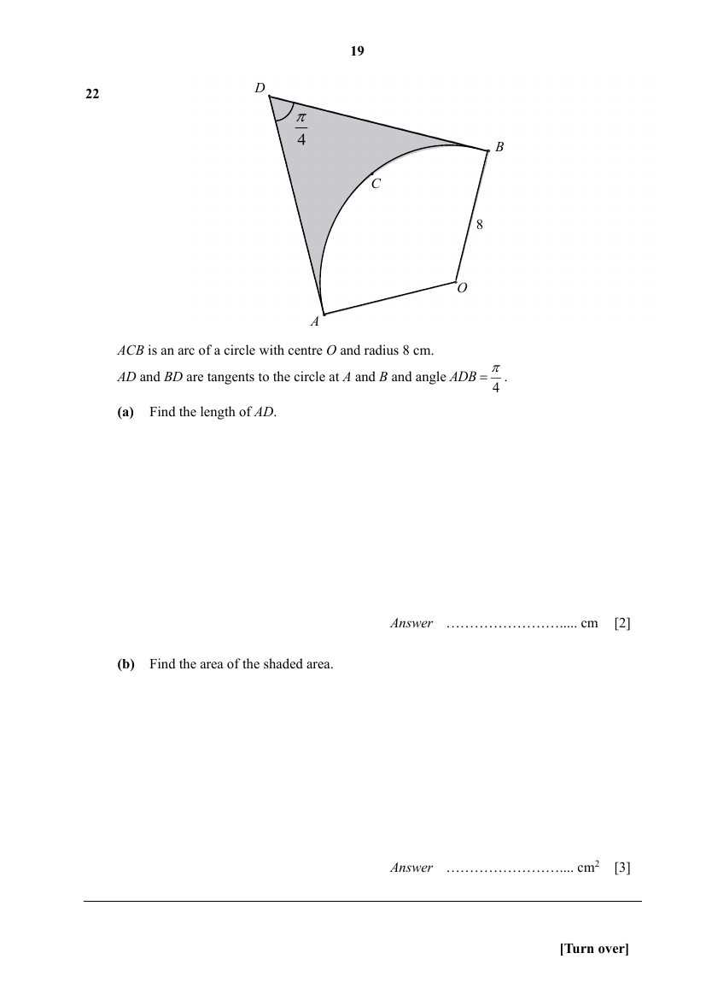

## Question

> **Marks:** (a) 2, (b) 3; total 5
> **Page:** 19

$ACB$ is an arc of a circle with centre $O$ and radius 8 cm.
$AD$ and $BD$ are tangents to the circle at $A$ and $B$ and angle $ADB = \dfrac{\pi}{4}$.

**(a)** Find the length of $AD$. [2]

**(b)** Find the area of the shaded area. [3]

## Answer Scheme

**(a)**

$$
\angle ADO=\frac{\pi}{8}
$$

(tangents from an external point, where line $OD$ bisects $\angle ADB$)

$$
\tan\frac{\pi}{8}=\frac{8}{AD}
$$

$$
AD=\frac{8}{\tan\dfrac{\pi}{8}}\approx 19.3137=19.3\text{ cm (to 3 sf)}
$$

**(b)**

$$
\text{Shaded area}=2\times\frac{1}{2}\times 19.3137\times 8-\frac{1}{2}(8)^{2}\left(2\pi-\frac{\pi}{2}-\frac{\pi}{2}-\frac{\pi}{4}\right)
$$

$$
\approx 79.111=79.1\text{ cm}^{2}\text{ (to 3 sf)}
$$
