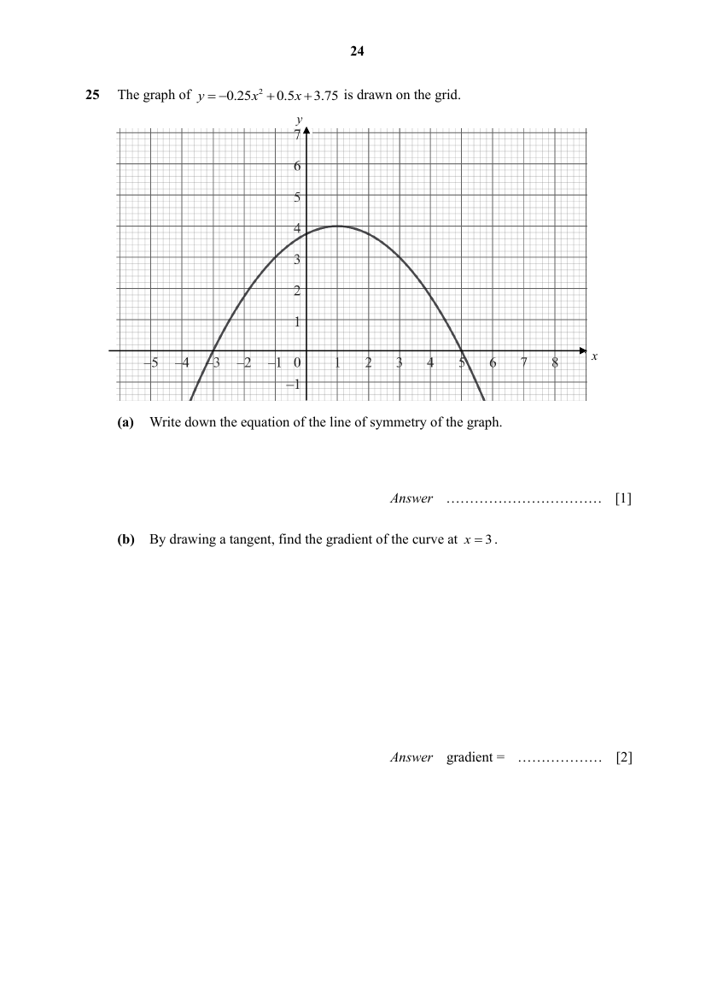

## Question

> **Marks:** (a) 1, (b) 2, (c) 1, (d) 3; total 7
> **Page:** 24–25

The graph of $y=-0.25x^{2}+0.5x+3.75$ is drawn on the grid.

**(a)** Write down the equation of the line of symmetry of the graph. [1]

**(b)** By drawing a tangent, find the gradient of the curve at $x=3$. [2]

**(c)** Explain how you can determine, from the graph, for a given value of $m$, whether $-0.25x^{2}+0.5x+3.75=m$ has two, one, or no real solutions. [1]

**(d)** By drawing a suitable straight line on the grid, solve the equation $-0.25x^{2}+0.5x+1.25=-0.5x$. [3]

## Answer Scheme

**(a)** $x=1$

**(b)**

$$
m=\frac{6-0}{0-6}=-1
$$

**(c)** The number of real solutions to the question is equal to the number of points where the horizontal line $y=m$ meets the graph.

**(d)** Draw $y=-0.5x+2.5$.

From the graph, $x=-1$ or $5$.
