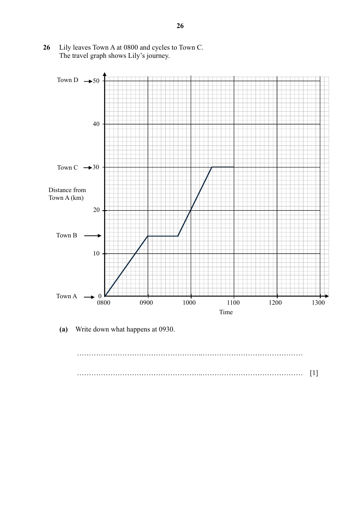
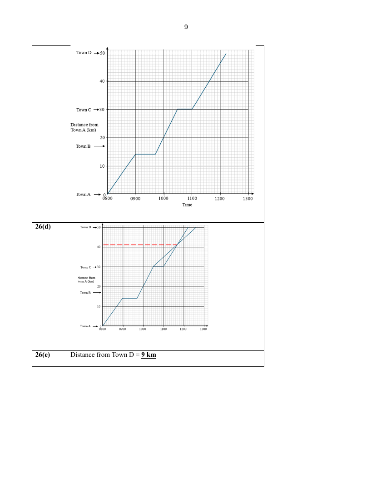

## Question

> **Marks:** (a) 1, (b) 2, (c) 2, (d) 1, (e) 1; total 7
> **Page:** 26–27

Lily leaves Town A at 0800 and cycles to Town C.
The travel graph shows Lily’s journey.

**(a)** Write down what happens at 0930. [1]

**(b)** Find Lily’s average speed, in kilometres per hour, from Town B to Town C. [2]

**(c)** Lily leaves Town C at 1100.
She continues to Town D at a constant speed of $16\dfrac{2}{3}$ kilometres per hour.
On the travel graph, complete Lily’s journey. [2]

**(d)** Emily leaves Town C at 1030 and arrives at Town D at 1236.
She cycles at a constant speed on the same road as Lily, without stopping.
Draw a line on the travel graph to show Emily’s journey. [1]

**(e)** Find the distance from Town D when Emily and Lily pass each other. [1]

## Answer Scheme

**(a)** Lily stopped (or rest / not moving / at Town B).

**(b)**

$$
\text{Average speed}=\frac{30-14}{\dfrac{48}{60}}=20\text{ km/h}
$$

**(c)**

$$
\text{Time taken}=\frac{20}{16\dfrac{2}{3}}=1\text{ h }12\text{ min}
$$

Correct straight line drawn.

**(d)** Line drawn on the travel graph. See the image above.

**(e)** Distance from Town D $= 9$ km
