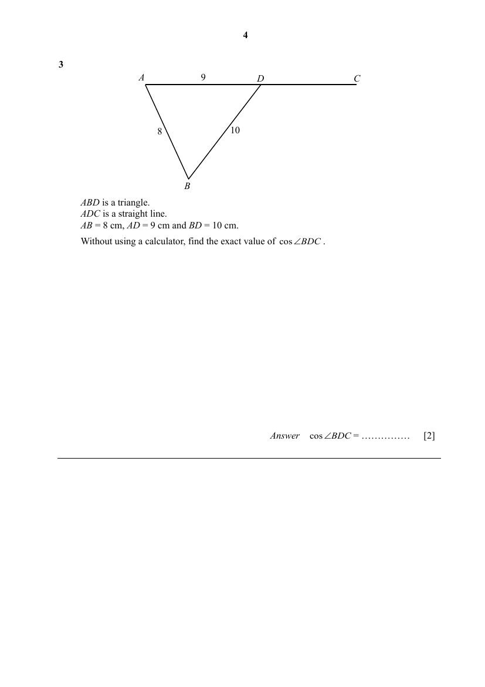

## Question

> **Marks:** 2
> **Page:** 4

$ABD$ is a triangle.
$ADC$ is a straight line.
$AB = 8$ cm, $AD = 9$ cm and $BD = 10$ cm.
Without using a calculator, find the exact value of $\cos\angle BDC$. [2]

## Answer Scheme

$$
\cos\angle BDC=\frac{9^{2}+10^{2}-8^{2}}{2(9)(10)}=\frac{13}{20}
$$

$$
\cos\angle BDC=-\frac{13}{20}
$$
