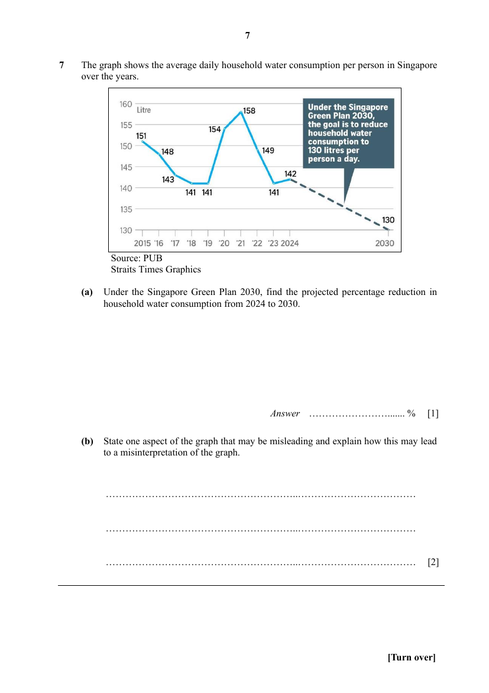

## Question

> **Marks:** (a) 1, (b) 2; total 3
> **Page:** 7

The graph shows the average daily household water consumption per person in Singapore over the years.

Source: PUB
Straits Times Graphics

**(a)** Under the Singapore Green Plan 2030, find the projected percentage reduction in household water consumption from 2024 to 2030. [1]

**(b)** State one aspect of the graph that may be misleading and explain how this may lead to a misinterpretation of the graph. [2]

## Answer Scheme

**(a)**

$$
\%\text{ reduction}=\frac{142-130}{142}\times 100\%=8.45\%\text{ (to 3 sf)}
$$

**(b)** The graph gives the impression that water consumption in 2021 doubled compared to 2018/19, when the actual increase is only about one-third. This misinterpretation arises because the vertical axis does not start from zero, exaggerating the fluctuations and making the changes appear more significant than they really are.

OR

It misleads us into thinking that there is a gradual downward trend in water consumption from 2024 to 2030, which might not be the case.
