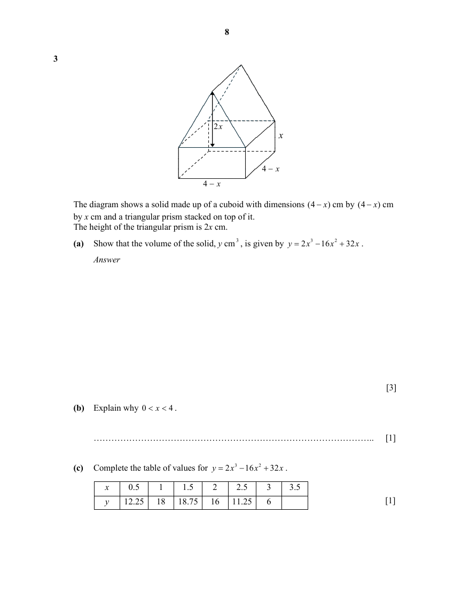
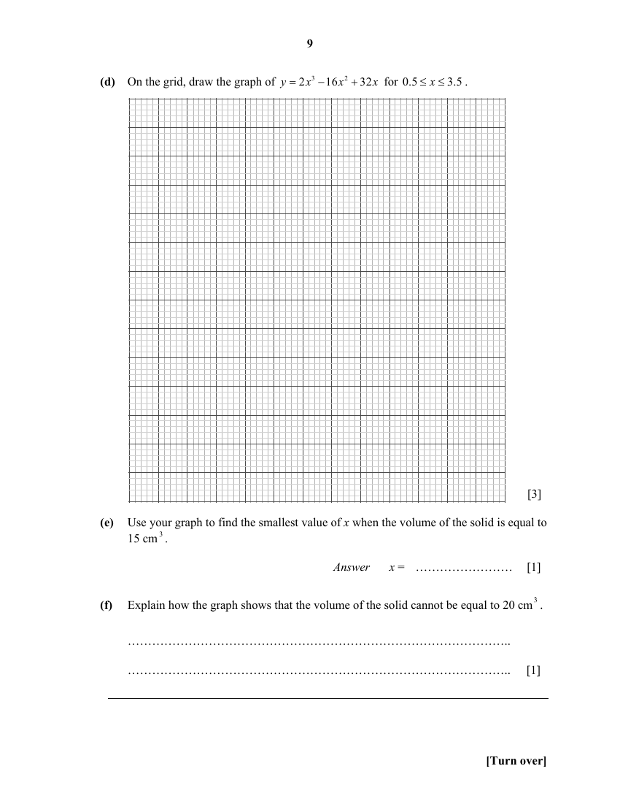

## Question

> **Marks:** (a) 3, (b) 1, (c) 1, (d) 3, (e) 1, (f) 1; total 10
> **Page:** 8–9

The diagram shows a solid made up of a cuboid with dimensions $(4-x)$ cm by $(4-x)$ cm by $x$ cm and a triangular prism stacked on top of it.
The height of the triangular prism is $2x$ cm.

**(a)** Show that the volume of the solid, $y\text{ cm}^{3}$, is given by $y=2x^{3}-16x^{2}+32x$. [3]

**(b)** Explain why $0<x<4$. [1]

**(c)** Complete the table of values for $y=2x^{3}-16x^{2}+32x$. [1]

| $x$ | 0.5 | 1 | 1.5 | 2 | 2.5 | 3 | 3.5 |
| --- | --- | --- | --- | --- | --- | --- | --- |
| $y$ | 12.25 | 18 | 18.75 | 16 | 11.25 | 6 | |

**(d)** On the grid, draw the graph of $y=2x^{3}-16x^{2}+32x$ for $0.5\leq x\leq 3.5$. [3]

**(e)** Use your graph to find the smallest value of $x$ when the volume of the solid is equal to $15\text{ cm}^{3}$. [1]

**(f)** Explain how the graph shows that the volume of the solid cannot be equal to $20\text{ cm}^{3}$. [1]

## Answer Scheme

**(a)**

$$
\text{Volume of the solid}=\frac{1}{2}(4-x)(2x)(4-x)+(4-x)^{2}x
$$

$$
=x(16-8x+x^{2})+x(16-8x+x^{2})
$$

$$
=x^{3}-8x^{2}+16x+x^{3}-8x^{2}+16x
$$

$$
=2x^{3}-16x^{2}+32x
$$

**(b)** The dimensions of the figure must be greater than 0. Therefore,

$$
4-x>0,\quad x<4
$$

and $x>0$.

$$
\therefore 0<x<4
$$

**(c)** $1.75$

**(d)**

**(e)** $0.65$

**(f)** From the graph the maximum value is 18.9, the volume cannot be greater than $18.9\text{ cm}^{3}$. Hence the volume of the solid cannot be $20\text{ cm}^{3}$.
