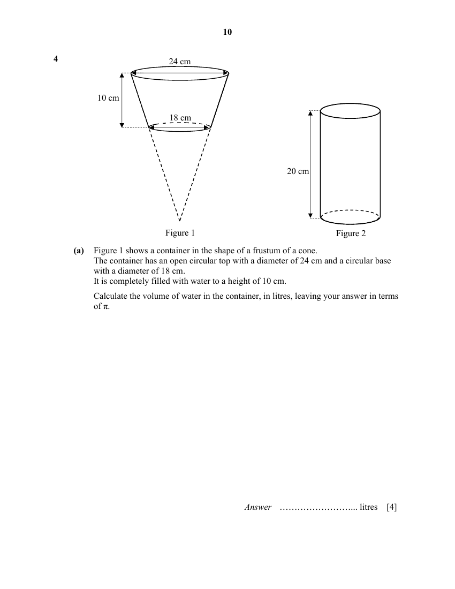

## Question

> **Marks:** (a) 4, (b) 4; total 8
> **Page:** 10–11

**(a)** Figure 1 shows a container in the shape of a frustum of a cone.
The container has an open circular top with a diameter of 24 cm and a circular base with a diameter of 18 cm.
It is completely filled with water to a height of 10 cm.
Calculate the volume of water in the container, in litres, leaving your answer in terms of $\pi$. [4]

**(b)** All the water is poured into an open cylindrical container of height 20 cm, as shown in Figure 2.
The water fills the cylinder to $\dfrac{3}{4}$ of its height.
Calculate the surface area of the cylindrical container that is not in contact with the water. [4]

## Answer Scheme

**(a)** Using similarity,

$$
\frac{h}{h-10}=\frac{24}{18}
$$

$$
18h=24h-240
$$

$$
h=40
$$

$$
\text{Volume of frustum}=\frac{1}{3}\pi(12)^{2}\times 40-\frac{1}{3}\pi(9)^{2}\times 30=1110\pi\text{ cm}^{3}=1.11\pi\text{ litres}
$$

**(b)**

$$
\pi r^{2}\times\frac{3}{4}\times 20=1110\pi
$$

$$
r^{2}=74
$$

$$
r=\sqrt{74}\approx 8.6023
$$

Therefore, area not in contact with water

$$
=2\pi\sqrt{74}\left[\frac{1}{4}(20)\right]\approx 270.250=270\text{ cm}^{2}\text{ (to 3 sf)}
$$
