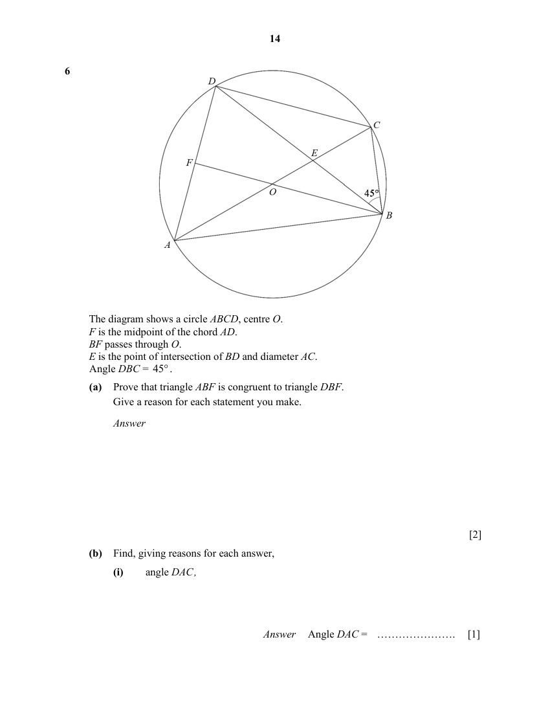

## Question

> **Marks:** (a) 2, (b)(i) 1, (b)(ii) 1, (b)(iii) 2, (b)(iv) 2; total 8
> **Page:** 14–15

The diagram shows a circle $ABCD$, centre $O$.
$F$ is the midpoint of the chord $AD$.
$BF$ passes through $O$.
$E$ is the point of intersection of $BD$ and diameter $AC$.
Angle $DBC=45^{\circ}$.

**(a)** Prove that triangle $ABF$ is congruent to triangle $DBF$.
Give a reason for each statement you make. [2]

**(b)** Find, giving reasons for each answer,

**(i)** angle $DAC$, [1]

**(ii)** angle $DCA$, [1]

**(iii)** angle $AOB$, [2]

**(iv)** angle $AED$. [2]

## Answer Scheme

**(a)** $DF=AF$ (given $F$ midpoint of $AD$)

$\angle BFD=\angle BFA=90^{\circ}$ (perpendicular bisector of chord)

$BF$ is common

$\therefore$ triangle $ABF\equiv$ triangle $DBF$ (SAS)

**(b)(i)** $\angle DAC=\angle DBC=45^{\circ}$ (angles in the same segment)

**(b)(ii)**

$$
\angle ADC=90^{\circ}\text{ (angle in a semicircle)}
$$

$$
\angle DCA=180^{\circ}-90^{\circ}-45^{\circ}\text{ (angle sum of a triangle)}=45^{\circ}
$$

**(b)(iii)**

$$
\angle DBA=\angle DCA=45^{\circ}\text{ (angles in the same segment)}
$$

$$
\angle OBA=\frac{45^{\circ}}{2}\text{ (triangle }ABF\equiv\text{ triangle }DBF)=22.5^{\circ}
$$

$$
\angle OAB=\angle OBA=22.5^{\circ}\text{ (base angles of an isosceles triangle)}
$$

$$
\angle AOB=180^{\circ}-22.5^{\circ}-22.5^{\circ}\text{ (angle sum of a triangle)}=135^{\circ}
$$

**(b)(iv)**

$$
\angle ACB=\frac{135^{\circ}}{2}\text{ (angle at the centre }=2\times\text{ angle at the circumference)}=67.5^{\circ}
$$

$$
\angle CEB=180^{\circ}-67.5^{\circ}-45^{\circ}\text{ (angle sum of a triangle)}=67.5^{\circ}
$$

$$
\angle AED=\angle CEB=67.5^{\circ}\text{ (vertically opposite angles)}
$$
