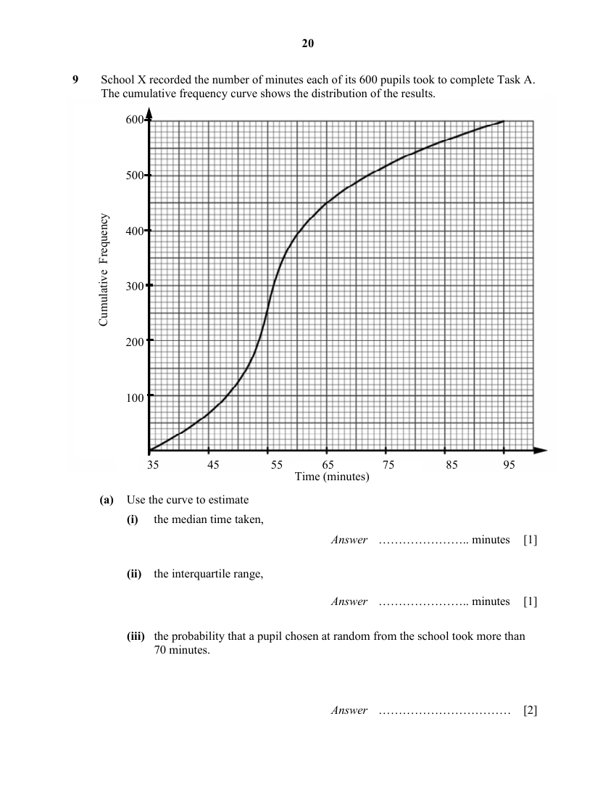
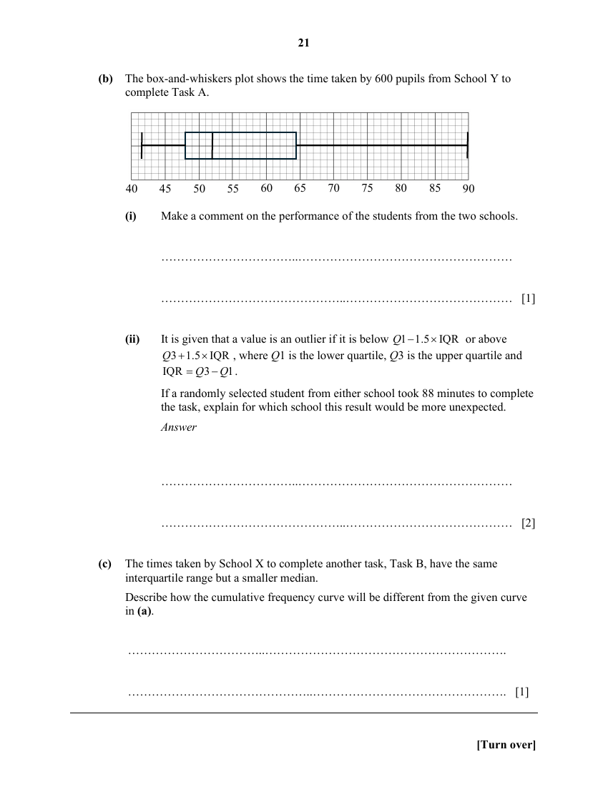

## Question

> **Marks:** (a)(i) 1, (a)(ii) 1, (a)(iii) 2, (b)(i) 1, (b)(ii) 2, (c) 1; total 8
> **Page:** 20–21

School X recorded the number of minutes each of its 600 pupils took to complete Task A.
The cumulative frequency curve shows the distribution of the results.

**(a)** Use the curve to estimate

**(i)** the median time taken, [1]

**(ii)** the interquartile range, [1]

**(iii)** the probability that a pupil chosen at random from the school took more than 70 minutes. [2]

**(b)** The box-and-whiskers plot shows the time taken by 600 pupils from School Y to complete Task A.

**(i)** Make a comment on the performance of the students from the two schools. [1]

**(ii)** It is given that a value is an outlier if it is below $Q1-1.5\times\text{IQR}$ or above $Q3+1.5\times\text{IQR}$, where $Q1$ is the lower quartile, $Q3$ is the upper quartile and $\text{IQR}=Q3-Q1$.
If a randomly selected student from either school took 88 minutes to complete the task, explain for which school this result would be more unexpected. [2]

**(c)** The times taken by School X to complete another task, Task B, have the same interquartile range but a smaller median.
Describe how the cumulative frequency curve will be different from the given curve in (a). [1]

## Answer Scheme

**(a)(i)** 56 minutes

**(a)(ii)** $\text{IQR}=65-51.5=13.5$ minutes

**(a)(iii)** Number of students who took more than 70 minutes $=600-490=110$.

$$
\text{Probability}=\frac{110}{600}=\frac{11}{60}
$$

**(b)(i)** The median time taken by students from School X to complete the task is 56 minutes, while for School Y it is 52 minutes. This means that students from School Y, on average, complete the task faster than those from School X.

**(b)(ii)** For School X: upper boundary $=85.25$.

For School Y: upper boundary $=89.25$.

88 minutes is considered an outlier for School X, but not for School Y. Therefore, 88 minutes would be considered more unexpected for School X.

**(c)** Since both tasks have the same IQR, the steepness of the curve will remain the same, but the curve will be shifted to the left because of the smaller median.
