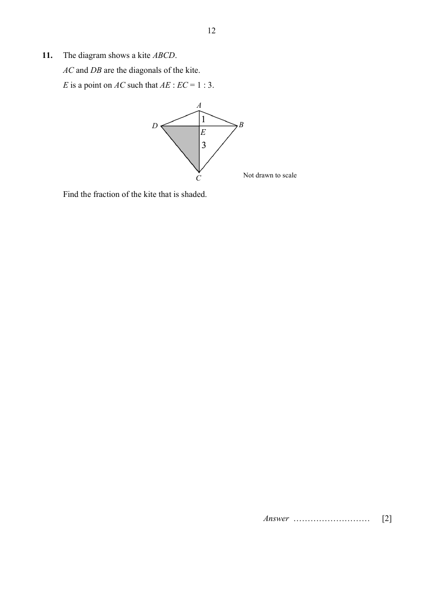

## Question

> **Marks:** 2
> **Page:** 12

The diagram shows a kite $ABCD$. $AC$ and $DB$ are the diagonals of the kite. $E$ is a point on $AC$ such that $AE:EC = 1:3$.

Find the fraction of the kite that is shaded. [2]

## Answer Scheme

The diagram shows a kite $ABCD$. $AC$ and $DB$ are the diagonals of the kite. $E$ is a point on $AC$ such that $AE:EC=1:3$.

Find the fraction of the kite that is shaded.

$$
\begin{aligned}
\dfrac{\text{Area of smaller triangle}}{\text{Area of bigger triangle}}&=\dfrac{\dfrac{1}{2}\times B\times H_{1}}{\dfrac{1}{2}\times B\times H_{2}}\\
&=\dfrac{1}{3}\\
\dfrac{\text{Area of shaded triangle}}{\text{Diagram}}&=\dfrac{1.5}{4}=\dfrac{3}{8}
\end{aligned}
$$

Alternative solution.

Let the height of the smaller triangle be $H_{1}$. Let the height of the larger triangle be $H_{2}$. $H_{2}=3H_{1}$.

$$
\begin{aligned}
\text{Fraction of the kite that is shaded}&=\dfrac{\dfrac{1}{2}\left(\dfrac{1}{2}\times H_{2}\times B\right)}{\left(\dfrac{1}{2}\times H_{1}\times B\right)+\left(\dfrac{1}{2}\times H_{2}\times B\right)}\\
&=\dfrac{\dfrac{1}{2}\left(\dfrac{1}{2}\times 3H_{1}\times B\right)}{\left(\dfrac{1}{2}\times H_{1}\times B\right)+\left(\dfrac{1}{2}\times 3H_{1}\times B\right)}\\
&=\dfrac{\dfrac{1}{2}\left(\dfrac{1}{2}\times 3H_{1}\times B\right)}{\left(\dfrac{1}{2}\times H_{1}\times B\right)(1+3)}\\
&=\dfrac{3}{8}
\end{aligned}
$$
